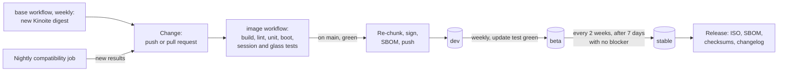
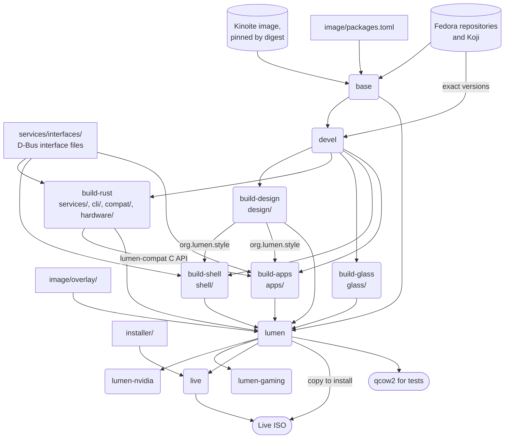
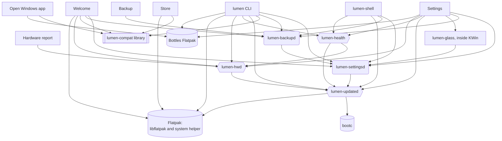

<!--
SPDX-FileCopyrightText: 2026 Lumen OS contributors

SPDX-License-Identifier: GPL-3.0-or-later
-->

# Lumen OS architecture

Status: accepted by the owner at step 0.8 (2026-10-27, [ADR 0004](decisions/0004-phase-0-review.md)), written against the spec as amended by [ADR 0001](decisions/0001-compete-with-windows.md) and [ADR 0002](decisions/0002-fix-spec-errors-from-architecture-review.md). Part 1 (sections 1 to 8, step 0.1) covers the components and how they talk to each other. Part 2 (sections 9 and 10, step 0.2) covers how they are built and released, and draws the dependency graphs.

[docs/spec.md](spec.md) is the source of truth. This document turns it into concrete names, paths and interfaces. Where the spec left something open, this document proposed an answer, and the owner accepted all of them at step 0.8 ([ADR 0004](decisions/0004-phase-0-review.md)). If a step finds that one doesn't work, it records the change in a new ADR. The spec errors found while writing it are listed in [section 8](#8-spec-problems-and-open-questions) and fixed by [ADR 0002](decisions/0002-fix-spec-errors-from-architecture-review.md).

The interface sketches below (methods, properties, signals) show intent, not the final API. The step that builds each part fixes its exact shape.

## 1. The big picture

| Layer | Contents | Made by |
| --- | --- | --- |
| Apps | Settings, Store, Welcome, Backup, hardware report, "Open Windows app"; Flatpak apps, including Bottles for Windows apps | Lumen; Flathub |
| Shell | lumen-shell (Plasma shell package `org.lumen.desktop`) | Lumen, on Plasma backends |
| Compositor | KWin 6 + the lumen-glass effect | KDE + Lumen |
| Services | lumen-updated, lumen-health, lumen-hwd, lumen-settingsd, lumen-backupd | Lumen |
| Base image | systemd, SELinux, NetworkManager, PipeWire, Flatpak, bootc; read-only `/usr` | Fedora (Kinoite) |
| Kernel and firmware | Linux, Mesa, firmware, Secure Boot, LUKS2 + TPM2 | Fedora |

Three things cut across the layers: the **design tokens** (one `tokens.json`, exported at build time to every toolkit and to the glass shader), the **`lumen` CLI** (it calls the same D-Bus services as the GUI) and the **compatibility database** (one signed file of Windows app ratings, read offline through the `lumen-compat` crate by the Store, the "Open Windows app" dialog, Welcome and the CLI).

Three rules shape every interface in this document:

1. **One owner per job.** Each piece of state has exactly one owner. Only lumen-updated runs bootc; only lumen-settingsd writes `~/.config/lumen/`. Everything else asks the owner over D-Bus.
2. **The GUI and the CLI share one path.** Anything the Settings app can do, `lumen` does with the same D-Bus call, so they can never disagree (spec, "lumen CLI and services").
3. **Reuse upstream interfaces.** Where KDE or freedesktop.org already has a D-Bus API or Wayland protocol, Lumen uses it instead of inventing one.

## 2. Conventions

### D-Bus

- Bus name, object path and interface share one versioned name, freedesktop.org style: bus name `org.lumen.Updates1`, object path `/org/lumen/Updates1`, interface `org.lumen.Updates1`. A breaking change gets a new version (`Updates2`); the old one stays for one Fedora release.
- The interface XML files are the contract and live in `services/interfaces/` (step 5.1). Rust services implement them with zbus, the CLI uses a shared Rust crate, and the Qt apps generate their proxies from the same XML with `qdbusxml2cpp`.
- Services are D-Bus activated (started on first call) and run as systemd units with `Type=dbus`.
- Errors are named D-Bus errors (`org.lumen.Error.NotAuthorized`, `.Busy`, `.InvalidValue` and so on) carrying a plain-English, translated message that the GUI can show as it is.
- Long jobs return at once with a job object path, send `Progress` signals and end with `Finished(success, message)`.
- Lumen's D-Bus APIs are for Lumen components only. Flatpak apps can't reach them (Flatpak filters the buses); they get Lumen's look and settings through portals.
- System services never call into a user session. They emit signals, and session components (mostly the shell) listen and react. Session components call system services, never the other way round.

### Privilege

- Every privileged call on a system service is checked with polkit. Action IDs are `org.lumen.<service>.<action>`, for example `org.lumen.updates.rollback`. The default is `auth_admin_keep`: the admin password, remembered for 5 minutes (polkit's own timeout, which is what the spec asks for). Read-only calls need no password.
- Session services run as the user, need no polkit and can only touch that user's data.
- Units use systemd hardening (`NoNewPrivileges`, `ProtectSystem`, `ProtectHome`, `PrivateTmp`, syscall filters), loosened only where a tool needs it. For example, bootc has to write `/sysroot` and `/boot`. The per-service template is part of step 5.1.

### Files

| Path | Writable | Owner | Contents |
| --- | --- | --- | --- |
| `/usr/bin/lumen` | No | image | The CLI |
| `/usr/libexec/lumen-*` | No | image | Service binaries |
| `/usr/share/lumen/` | No | image | Data that ships with the image: `tokens/tokens.json`, `settings/schema.toml`, `hardware.json`, `app-aliases.json`, `compat/windows-apps.json` |
| Image `/etc` | No (merged into the writable `/etc`) | image | Config defaults that can only live in `/etc`; bootc 3-way merges them with local changes on update. Everything else goes in `/usr/lib` or `/usr/share`. Never `/usr/etc` (ADR 0002) |
| `/etc/lumen/` | Yes | system services | Machine-wide Lumen settings (see [Q7](#8-spec-problems-and-open-questions)) |
| `/var/lib/lumen/` | Yes | system services | `glass-tier`, `updates/` (history, held versions), `health/` (logs), `compat/` (newer signed compatibility database) |
| `~/.config/lumen/*.toml` | Yes | lumen-settingsd | The user's Lumen settings |
| `~/.local/state/lumen/` | Yes | session services | Per-user state, such as backup results |

### App IDs

Lumen's apps use `org.lumen.Settings`, `org.lumen.Store`, `org.lumen.Welcome`, `org.lumen.Backup`, `org.lumen.HardwareReport` and `org.lumen.WindowsApp`. On Wayland the app ID is how KWin and the dock match a window to its app, so it must equal the desktop file name.

## 3. Component catalogue

| Component | Repo folder | Language | Runs as | Ships as |
| --- | --- | --- | --- | --- |
| Base image | `image/` | Containerfile, TOML | n/a | OCI image `ghcr.io/<org>/lumen:<channel>` and variants |
| lumen-glass | `glass/` | C++, GLSL | Inside `kwin_wayland` (user session) | RPM, built in a Containerfile stage |
| Design tokens and exporters | `design/tokens/` | JSON plus exporters | Build time only | Files in the image |
| lumen-shell | `shell/` | QML, C++ QML plugins, KWin scripts (JS) | Inside `plasmashell` (user session) | RPM, built in a Containerfile stage |
| lumen-updated | `services/updated` | Rust | System, root | RPM |
| lumen-health | `services/health` | Rust | System | RPM |
| lumen-hwd | `services/hwd` | Rust | System | RPM |
| lumen-settingsd | `services/settingsd` | Rust | User session | RPM |
| lumen-backupd | `services/backupd` | Rust | User session | RPM |
| `lumen` CLI | `cli/` | Rust | User | RPM |
| Settings | `apps/settings` | C++/QML | User | RPM |
| Store | `apps/store` | C++/QML | User | RPM |
| Welcome | `apps/welcome` | C++/QML | First-boot session, then user | RPM |
| Backup | `apps/backup` | C++/QML | User | RPM |
| "Open Windows app" dialog | `apps/windows-app` | C++/QML | User | RPM |
| Hardware report | `apps/hwreport` | C++/QML | Live session | RPM |
| Compatibility database | `compat/` | JSON, JSON schema | Data | `/usr/share/lumen/compat/`, refreshed by lumen-updated |
| lumen-compat | `compat/` | Rust library | Inside its callers | RPM |
| Lumen Setup for Windows | `windows-setup/` | C++/Qt (fork of Fedora Media Writer) | Windows | Code-signed Windows program, built in CI |
| Installer | `installer/` | Kickstart, theme | Install media | Part of the ISO |
| Hardware database | `hardware/hardware.json` | JSON | Data | `/usr/share/lumen/hardware.json` |

Lumen's own apps ship as RPMs in the image, not as Flatpaks. They are part of the OS: they need the system services and must match the image version, like KDE's System Settings does today. Third-party apps are Flatpaks only, including Bottles, which runs Windows apps.

Where each RPM gets built is [section 9.2](#92-where-each-package-is-built).

## 4. Components

### 4.1 Base image

Kinoite pinned by digest, managed by bootc. Lumen adds packages from `image/packages.toml`, the overlay and systemd presets.

Some stock parts compete with a Lumen owner, so the image turns them off:

| Upstream part | Why it goes | Replaced by |
| --- | --- | --- |
| Discover and its update notifier | A second app store and update prompt | Store and lumen-updated |
| `rpm-ostreed-automatic.timer`, `bootc-fetch-apply-updates.timer` (masked) | Second updaters. The bootc one applies updates and reboots without asking | lumen-updated |
| `rpm-ostree-countme.timer` (masked) | Sends a weekly anonymous count to Fedora; the spec says no telemetry | Nothing |
| KWin's `blur` and `contrast` effects | lumen-glass serves the same Wayland global (`org_kde_kwin_blur_manager`). Two effects can't both own it | lumen-glass |
| Stock Plasma panels and default plasmoids | Spec | lumen-shell |

How the image does it (step 1.3): Discover's packages are removed in `image/packages.toml`; the three timers are masked in the Containerfile; the stock layout gives way to Lumen's global theme `org.lumen.desktop`, made the default in `/etc/xdg/kdeglobals`. Its layout script starts new users with an interim 32 px top bar of stock widgets (app menu, open windows, system tray, clock) where lumen-shell's top bar will go, so Wi-Fi, sound and notifications work until lumen-shell replaces it at step 4.2 (the owner's choice over a bare desktop, 2026-10-27). The theme otherwise copies Fedora's settings until step 2.11 replaces it.

Talks to: the image registry (`ghcr.io`) through bootc, with signatures checked against `/etc/containers/policy.json` and the sigstore settings in `/etc/containers/registries.d/` (step 1.7).

### 4.2 lumen-glass (compositor effect)

A KWin effect plugin loaded by `kwin_wayland` in the user's session. Built against that image's exact KWin (CLAUDE.md build rule).

**Offers**

- Wayland:
  - `org_kde_kwin_blur_manager`: the blur region, inherited from the stock blur effect. Qt apps reach it with `KWindowEffects::enableBlurBehind`.
  - `lumen_glass_manager_v1`: a small Lumen protocol that lets a surface name its glass role (`bar`, `dock`, `menu`, `popover`, `notification`, `sidebar`, `titlebar`). See [Q6](#8-spec-problems-and-open-questions).
  - `ext_background_effect_manager_v1`: later, once KWin supports it (spec).
- D-Bus: `org.lumen.Glass1` on the session bus, owned by the KWin process, path `/org/lumen/Glass1`.
  - Properties: `ActiveTier`, `BenchmarkTier`, `TierReason` (for example "Battery saver is on").
  - Method: `Reload()` re-reads tokens and settings (mainly for tests).
  - Signal: `TierChanged(tier, reason)`.
  - The Settings Appearance page and the session tests read the effective tier here.

**Uses**

- `/usr/share/lumen/tokens/tokens.json`: glass presets per role, spring presets.
- `/var/lib/lumen/glass-tier`: the first-boot benchmark result.
- `org.lumen.Settings1` `Changed` signal for `appearance.*`, `glass.*` and `accessibility.*` keys: theme, accent, tier override, Reduce Transparency, Reduce Motion.
- The power profile on the system bus (`org.freedesktop.UPower.PowerProfiles`, `ActiveProfile`), to drop a tier in power-saver mode.

**How a window gets its role**

1. The role the client set through `lumen_glass_manager_v1`. Lumen's shell and apps always set one.
2. Otherwise, from the window type KWin already knows: menus get `menu`, applet popups and OSDs get `popover`, notifications get `notification`, anything else that asked for blur gets `sidebar`.
3. GTK apps can't ask, because there is no GTK module (ADR 0002). Those on the opt-in list of app IDs, shipped with the tokens, get glass behind the whole window with the `sidebar` preset. It shows only where the GTK theme made the window translucent: header bars and sidebars.
4. The title bar area gets `titlebar` directly, because the window decoration also runs inside KWin.
5. A window that asks for nothing gets rounded corners and a soft shadow only (spec).

**How the tier is chosen.** The effective tier is the lowest of:

- the benchmark result, or the user's override `glass.tier` if it isn't `auto`;
- one tier lower while the power profile is power-saver;
- Solid when Reduce Transparency is on, the session is remote, or KWin is rendering in software.

Reduce Motion turns off morphing and spring animations whatever the tier.

**Benchmark** (step 3.11): a system oneshot, `lumen-glass-benchmark.service`, runs before the first login, and again when the GPU changes. It renders the 8-surface test scene off-screen on the GPU's render node, at the main display's native resolution, with the same shaders, and writes `/var/lib/lumen/glass-tier`. This keeps the result in system state, where the spec puts it, and out of the user's first session.

### 4.3 Design tokens

`design/tokens/tokens.json` (checked by a JSON schema) is exported during the image build:

| Output | Installed at | Read by |
| --- | --- | --- |
| QML module `org.lumen.style` | Qt's QML import path | lumen-shell, Lumen apps |
| `tokens.json` itself | `/usr/share/lumen/tokens/` | lumen-glass, lumen-settingsd |
| KDE colour schemes | `/usr/share/color-schemes/` | Qt and KDE apps (through `kdeglobals`) |
| Kvantum theme | `/usr/share/Kvantum/Lumen/` | Qt apps |
| GTK 4 / libadwaita CSS | A template in `/usr/share/lumen/gtk-4.0/`; lumen-settingsd writes the user's copy to `~/.config/gtk-4.0/gtk.css` | GTK 4 apps |
| GTK 3 theme | `/usr/share/themes/Lumen/` | GTK 3 apps |
| Icon and cursor theme config | `/usr/share/icons/` | All apps |
| Window decoration (KDecoration plugin) and global theme `org.lumen.desktop` | KWin's decoration plugin path, `/usr/share/plasma/look-and-feel/` | KWin, Plasma |

Accent and light/dark are user choices, so they are applied at run time by lumen-settingsd ([flow 5.1](#51-changing-a-setting)).

Flatpak apps can't see host theme files. They get light/dark, accent and contrast from the Settings portal (`org.freedesktop.appearance`, served by xdg-desktop-portal-kde from `kdeglobals`). Full theming inside Flatpaks needs more: GTK 3 Flatpaks need the theme as a Flatpak extension (`org.gtk.Gtk3theme.Lumen`), and GTK 4 Flatpaks only see `~/.config/gtk-4.0` with a filesystem override. This is [risk 15](risks.md#15-flatpak-apps-dont-match-the-lumen-look) in the risk register; Phase 2 decides how far to go.

### 4.4 lumen-shell

`plasmashell` loads the shell package `org.lumen.desktop` (how it is selected is step 4.1). The UI is QML; small C++ QML plugins do what QML can't.

| Part | Talks to |
| --- | --- |
| Top bar | Tray (StatusNotifierItem, `org.kde.StatusNotifierWatcher`), NetworkManager, PipeWire (through plasma-pa), UPower, MPRIS (`org.mpris.MediaPlayer2.*`), AccountsService |
| Camera, mic and location indicators | PipeWire streams; GeoClue2 (`org.freedesktop.GeoClue2`, `InUse`). A program that opens `/dev/video*` directly, bypassing PipeWire, isn't seen: on the risk register's [watch list](risks.md#watch-list) |
| Dock | TaskManager library (Wayland `org_kde_plasma_window_management`), KService for pins, KActivities for recent files, launcher API (`com.canonical.Unity.LauncherEntry`) for progress and badges |
| Command palette | KRunner library in-process, plus D-Bus runners (`org.kde.krunner1`); Baloo for files; a Lumen runner for Settings pages (deep links) |
| Quick settings | NetworkManager, BlueZ (BluezQt), power profiles, KWin Night Light (`org.kde.KWin.NightLight`), PowerDevil for brightness (`org.kde.Solid.PowerManagement`), plasma-pa, lumen-settingsd (dark mode) |
| Notification centre, focus modes | Plasma's notification server (it owns `org.freedesktop.Notifications`); focus-mode settings in lumen-settingsd |
| Overview, tiling, auto-tile | KWin Overview effect (restyled), KWin custom tiles, KWin script `lumen-autotile` (configured through `kwinrc`) |
| Lock screen, login screen, OSDs | KScreenLocker theme; Plasma Login Manager's greeter, which runs on its own KWin and Plasma ([ADR 0005](decisions/0005-plasma-login-manager.md)); Plasma OSD service (`org.kde.osdService`) |
| Shortcuts | KGlobalAccel (`org.kde.kglobalaccel`); Super on its own is a KWin modifier-only shortcut |
| Glass | `lumen_glass_manager_v1` to set each surface's role; `org.lumen.style` for tokens |

**The shell is the session-side listener for the system services.** System services can't post desktop notifications (that API lives on each user's session bus), and the shell already runs in every session. So the shell watches `org.lumen.Updates1` for `UpdateReady` and shows the spec's single "Update ready" notification with Restart Now, Tonight and Later. It does the same for Health problems and failed backups. If the shell isn't running, the Settings app shows the same state when it opens.

**The shell reads its own settings** (dock size, auto-hide, hot corners, top bar options) from lumen-settingsd (`dock.*`, `shell.*`) and reacts to `Changed`, rather than keeping them only in Plasma's applet config files. That way `lumen settings` can change them.

### 4.5 Services

| Service | Bus | Runs as | Started by | State |
| --- | --- | --- | --- | --- |
| lumen-updated | system | root | D-Bus activation, `lumen-updated.timer` | `/var/lib/lumen/updates/` |
| lumen-health | system | own system user, plus polkit for fixes | D-Bus activation | `/var/lib/lumen/health/` |
| lumen-hwd | system | own system user, plus polkit for changes | D-Bus activation | none |
| lumen-settingsd | session | user | D-Bus activation | `~/.config/lumen/` |
| lumen-backupd | session | user | D-Bus activation, user timers | `~/.local/state/lumen/backup/` |

Whether lumen-health and lumen-hwd can really run as their own unprivileged users, or need root for some reads and fixes, is checked at steps 5.8 to 5.10.

#### lumen-updated: `org.lumen.Updates1`

Owns OS image updates (bootc), Flatpaks in the system installation, firmware, compatibility database refreshes, rollback, the post-boot health check and the update history.

- **Uses:** the `bootc` command (`status --json`, `upgrade --check`, `upgrade`, `rollback`, `switch`; bootc has no D-Bus API); libflatpak; fwupd (`org.freedesktop.fwupd`); NetworkManager (`Metered`, state changes); UPower (`OnBattery`, charge level); systemd (`org.freedesktop.systemd1`); logind (`org.freedesktop.login1`) for restarts.
- **Started by:** the timer every 6 hours, and a NetworkManager "connected" signal when the last check is over 24 hours old.
- **Sketch:**
  - Properties: `State`, `LastCheck`, `Channel`, `AutoUpdate`, `Staged` (version and contents), `PendingSince`.
  - Methods: `Check()`, `Apply()`, `ScheduleRestart(when)` (now, tonight or later), `ListHistory()`, `Rollback()`, `SwitchTo(version)`, `SwitchVariant(variant)`, `SetChannel(channel)`, `InstallFirmware(devices)`.
  - Signals: `UpdateReady(version, needsRestart)`, `BootHealthResult(ok, details)`.
- **History:** bootc keeps only the booted, staged and rollback deployments, but Settings > Updates > History lists every installed version. So lumen-updated keeps its own log in `/var/lib/lumen/updates/`.
- **Compatibility database refresh.** lumen-updated downloads the newer database, checks its signature, and only then replaces `/var/lib/lumen/compat/windows-apps.json`. Readers trust that file because only lumen-updated (root) can write it, so they never verify, download or look anything up online. Where the file is published is decided at step 7.3.
- **Going back to an older version** needs CI to keep immutable dated tags (for example `stable-44.20261027`, [section 9.7](#97-versions-tags-and-keys)) next to the moving `stable` tag (release train, step 9.1). After a user goes back, the version they left is "held" so the next check doesn't offer it straight away; the hold lifts when a newer version appears.
- **Low priority:** downloads run in a transient unit with idle CPU and I/O scheduling.
- **Post-boot health check** (ADR 0002): within 2 minutes of boot and without waiting for a login, it checks that the login screen is up (`display-manager.service`, which is Plasma Login Manager, is active and its greeter is running), NetworkManager is running and no critical units failed. Two failed boots in a row fall back to the previous deployment; try greenboot for this before writing our own.
- **First-login check.** A user unit started at login waits for the shell. If the shell hasn't started, the unit opens a small standalone dialog ("The desktop didn't start after the update. Go back to the previous version?") that calls `Rollback()`. It can't use a notification, because Plasma's notification server runs inside the shell that failed.

#### lumen-health: `org.lumen.Health1`

| Check | Reads from |
| --- | --- |
| Disk below 10% free | Free space on `/`, `/var`, `/home` |
| Failed systemd units | `org.freedesktop.systemd1` |
| Update pending more than 14 days | `org.lumen.Updates1` `PendingSince` |
| Firewall off | firewalld (`org.fedoraproject.FirewallD1`) |
| Battery health below 80% | UPower (full charge against design capacity) |
| Missing driver or firmware | `org.lumen.Hardware1`, fwupd |
| SMART or NVMe disk errors | UDisks2 (`org.freedesktop.UDisks2`) |
| Broken Flatpak or permissions | `flatpak repair --dry-run` |
| Backup not run in 7 days | `org.lumen.Backup1` (per user, see below) |
| Time not synced | timedated (`org.freedesktop.timedate1`, `NTPSynchronized`) |
| Windows Fast Startup left the Windows drive locked | The Windows partition's hibernation state (UDisks2) |
| Clock differs from Windows | timedated (`LocalRTC`) and the Windows clock setting, read from the Windows drive |
| Lumen boot entry missing | EFI boot entries and boot order (EFI variables) |
| Firmware lacks the Microsoft UEFI CA 2023 | `org.lumen.Hardware1` |

The last four are the dual-boot checks (step 7.10); they only run when a Windows install is present.

- **Sketch:** `RunChecks()` returns a list of (check, status, plain-English message, fix); `ApplyFix(fix)`; `Reset(mode)` for "Reset Lumen" (keep files or erase everything; how "erase everything" works on a bootc system is worked out at step 5.22); property `LastResults`; signal `ResultsChanged`.
- **Per-user checks run in the session.** Two checks are about one user's things: backup age, and caches and rootless containers in the storage cleaner. A system service can't see a user's session bus or (with `ProtectHome`) their home folder. So lumen-health runs the system checks, and the Settings app and `lumen health` add the per-user ones from lumen-backupd and the user's own disk use.

#### lumen-hwd: `org.lumen.Hardware1`

- **Uses:** sysfs and the hwdata ID lists (what `lspci` and `lsusb` read), fwupd, EFI variables (Secure Boot state, and the `db` certificate list for the Microsoft UEFI CA 2023 check), the TPM (`/sys/class/tpm`), fprintd (`net.reactivated.Fprint`), NetworkManager (Wi-Fi), V4L2 (webcam), ALSA (audio devices), `/sys/power` (sleep support), UPower.
- **Compares with** `/usr/share/lumen/hardware.json`: known good, known issues with workarounds, known broken.
- **Sketch:** `Report()` returns JSON with the same schema as `lumen hw report --json`; `DriverStatus()`; `SwitchToNvidiaImage()` explains MOK enrolment, then calls `org.lumen.Updates1.SwitchVariant("nvidia")`, because only lumen-updated runs bootc. Signal: `DevicesChanged`.
- Also runs in the install USB's live session, for the hardware report (ADR 0002).

#### lumen-settingsd: `org.lumen.Settings1`

- **Stores** `~/.config/lumen/<namespace>.toml`: the key `appearance.theme` is `theme` in `appearance.toml`.
- **A schema** in `/usr/share/lumen/settings/schema.toml` gives each key its type, default, allowed values and owner. Unknown keys are refused, so a typo fails loudly. Defaults come from the schema, so the files hold only what the user changed.
- **Sketch:** `Get(key)`, `Set(key, value)`, `List(prefix)`, `Reset(key)`, `Export()`, `Import(toml)`; signal `Changed(key, value)`.
- Writes are atomic (temporary file, then rename). A file watch notices hand edits and emits `Changed`, so "every setting is also a config file" works in both directions.
- **Bridges.** Some keys must also reach upstream settings stores:

| Lumen key | Also applied to |
| --- | --- |
| `appearance.theme`, `appearance.accent` | KDE colour scheme and accent in `kdeglobals` (xdg-desktop-portal-kde then tells Flatpak and GTK apps); regenerates `~/.config/gtk-4.0/gtk.css`; GTK 3 settings |
| `accessibility.reduce_motion` | KDE animation speed, GTK `gtk-enable-animations` |
| `dock.*`, `shell.*`, `glass.*` | Nothing: Lumen components read them directly |
| `updates.*` | Forwarded to `org.lumen.Updates1` (machine-wide, see [Q7](#8-spec-problems-and-open-questions)) |

Settings that already have an upstream owner (Wi-Fi networks, displays, Bluetooth pairings) stay with that owner, and the Settings app talks to it directly. Whether `lumen settings` should also wrap them is [Q9](#8-spec-problems-and-open-questions).

#### lumen-backupd: `org.lumen.Backup1`

- Runs restic as the user, so a backup holds what that user can read.
- **Destinations:** external drives (mounted through UDisks2), SMB/NFS shares, S3-compatible storage (restic supports S3 natively). How shares are reached without root is decided at step 6.8.
- **Secrets:** repository passwords live in the Secret Service (`org.freedesktop.secrets`, provided by KWallet), never in config files.
- **Settings:** schedule, retention and exclusions are `backup.*` keys in lumen-settingsd. The destination list and secrets belong to lumen-backupd.
- **Schedules:** systemd user timers that call lumen-backupd.
- **Sketch:** `ListDestinations()`, `AddDestination(...)`, `RunNow(destination)`, `ListSnapshots(destination)`, `Restore(snapshot, paths, target)`; property `LastSuccess`; signals `JobProgress`, `JobFinished`.

"Previous versions" in Files is a separate thing: it reads snapper's hourly `/home` snapshots, not restic (step 6.9).

### 4.6 `lumen` CLI

`/usr/bin/lumen`, Rust with clap. Each command maps straight onto D-Bus calls:

| Command | Calls |
| --- | --- |
| `lumen update`, `lumen rollback` | `org.lumen.Updates1` |
| `lumen settings` | `org.lumen.Settings1` |
| `lumen health` | `org.lumen.Health1`, plus `org.lumen.Backup1` for the per-user checks |
| `lumen hw report` | `org.lumen.Hardware1` |
| `lumen app install / remove / list / search` | libflatpak and `app-aliases.json`, the same as the Store (see 4.7) |
| `lumen app check <file>`, `lumen app list --windows` | lumen-compat and Bottles, the same as the "Open Windows app" dialog (see 4.9) |
| `lumen dev enable` | toolbox and distrobox as the user; turning on SSH goes through `org.freedesktop.systemd1` and firewalld, under polkit |
| `lumen backup` | `org.lumen.Backup1` |
| `lumen glass tier` | `org.lumen.Settings1`, key `glass.tier` (lumen-glass reacts to the change) |

- `--json` prints the same structures the D-Bus calls return. Tests use it to check that the GUI and CLI agree.
- Completions for bash, zsh and fish are generated by clap and installed in the standard paths.
- Calls allow interactive authorisation, so polkit can ask for the password. Without a graphical session (over SSH), `lumen` starts polkit's text agent, `pkttyagent`.

### 4.7 Apps

| App | Talks to |
| --- | --- |
| Settings | lumen-settingsd, all system services, `org.lumen.Glass1`, KDE settings backends (KScreen, plasma-nm, BlueZ, plasma-pa, PowerDevil), AccountsService, firewalld, the Flatpak permission store, Bottles (Apps → Windows apps), Plasma's remote desktop server KRdp ("Get help from a friend" on the same network; for help over the internet the page offers RustDesk from the Store, ADR 0002). Opens on deep links `lumen-settings://<page>[/<section>]` (a URL scheme handler in its desktop file); the palette and Health fixes use them |
| Store | libflatpak (system installation; Flatpak's own system helper does the privileged part under polkit), AppStream metadata, Flathub, `app-aliases.json`, lumen-compat (ratings next to Windows-name searches, the Windows alternatives collection, anti-cheat status). Installs websites as apps ([Q11](#8-spec-problems-and-open-questions)) |
| Welcome | First-boot part: localed (`org.freedesktop.locale1`), NetworkManager, AccountsService, TPM2 enrolment (see [Q8](#8-spec-problems-and-open-questions)). User part: lumen-settingsd, the Store backend, UDisks2 (import drive; unlocks a BitLocker drive with its recovery key), lumen-compat ("Your Windows apps"), lumen-backupd (offer backup when a second drive exists) |
| Backup | lumen-backupd |
| Hardware report | lumen-hwd |
| "Open Windows app" | lumen-compat, Bottles (see 4.9) |

There is no Lumen app daemon. Flatpak's system helper already is the service, so the Store and `lumen app` stay in step by both using libflatpak and the same alias file. Once an app is installed, lumen-updated keeps it up to date.

### 4.8 Installer

The install media is a live ISO built from the Lumen image (ADR 0002; try Universal Blue's Titanoboa first, at step 1.8). It boots into a Lumen live session, which runs the hardware report through lumen-hwd and then starts Anaconda WebUI with Lumen's kickstart and theme from `installer/`. How the live ISO hands the image to Anaconda is worked out at step 1.8.

- After install, the system must track `ghcr.io/<org>/lumen:<channel>` and enforce the signature policy from its first update.
- "Install alongside Windows" uses free space made from inside Windows and never resizes a BitLocker volume (spec).
- The live session must not run Welcome; that belongs to the installed system's first boot.
- Fallback, if no live ISO works by Phase 6: bootc-image-builder's `anaconda-iso` with a partial kickstart, so the user picks the disk and mode. bootc-image-builder adds the `ostreecontainer` kickstart command that writes the image. This drops the live hardware report, so it needs the owner's approval first.

### 4.9 Windows apps and switching

**Compatibility database.** `compat/windows-apps.json` (checked against its JSON schema in CI, published under ODbL 1.0). It ships in the image at `/usr/share/lumen/compat/`, and lumen-updated keeps a newer signed copy in `/var/lib/lumen/compat/` between image updates. Readers use whichever copy is newer. A lookup never touches the network.

**lumen-compat.** A Rust crate that identifies a file (PE version info, installer type, SHA-256, Steam App ID) and looks it up. The spec makes it the only lookup path for the Store, the dialog, Welcome and the CLI, so they can't disagree. The CLI links it directly. The C++ apps call it through a small C interface rather than through a daemon. A lookup is a local file read, so a service would only add a moving part ([Q10](#8-spec-problems-and-open-questions)).

**"Open Windows app" dialog** (`org.lumen.WindowsApp`):

- It is the default app for `.exe` and `.msi` files. Until it ships (step 7.5), those files open in Bottles directly (step 1.13).
- It reads the file through lumen-compat and shows the rating, the reason, alternatives and anti-cheat status.
- Install creates the app's own bottle with its recipe and runs the installer, by driving Bottles through its command-line tool (`bottles-cli`, run inside the Bottles Flatpak). The installer file reaches the sandbox through the document portal, so Bottles' permissions never widen. Whether `bottles-cli` can apply every recipe field (dependencies, DLL overrides, environment variables) is checked at step 7.5.
- Nothing installs until the user presses a button (spec).

**Bottles** (Flathub) runs each Windows app in its own bottle inside its Flatpak sandbox, with Bottles' default permissions (no home folder beyond Downloads). Settings → Apps → Windows apps and `lumen app list --windows` list the bottles; removing an app deletes its bottle. Games use Steam with Proton, Heroic or Lutris instead.

**Lumen Setup for Windows** runs on Windows before Lumen is on the machine, so it shares data with Lumen, not D-Bus:

- `hardware.json`, the same file lumen-hwd uses. The matching rules live in one Rust crate that both lumen-hwd and Setup link, for the same reason as lumen-compat ([Q10](#8-spec-problems-and-open-questions)).
- Windows' own tools and APIs for BitLocker, Fast Startup, Secure Boot and the UEFI CA 2023 check, shrinking the Windows partition and setting the Windows clock to UTC. Every change to Windows has its own confirm button (spec).
- Lumen's release files: it downloads the ISO with its checksum and signature over HTTPS, verifies them and writes the USB drive.

## 5. Key flows

### 5.1 Changing a setting

1. The user turns on dark mode in Quick settings or in Settings, or runs `lumen settings set appearance.theme dark`. All three call `org.lumen.Settings1.Set("appearance.theme", "dark")`.
2. lumen-settingsd checks the value against the schema and writes `~/.config/lumen/appearance.toml`.
3. The bridge applies the KDE colour scheme. xdg-desktop-portal-kde reports the new `color-scheme` to Flatpak and GTK apps; lumen-settingsd regenerates the GTK 4 CSS.
4. lumen-settingsd emits `Changed`. lumen-glass flips its tint direction; the shell and Lumen apps restyle. Nothing polls.

### 5.2 Update, restart and recovery

1. The timer (or a reconnect after more than 24 hours) starts lumen-updated.
2. It checks the OS image (`bootc upgrade --check`), then Flatpaks, then firmware.
3. On a metered network, or on battery below 20%, it waits.
4. It downloads at idle priority. bootc checks the image signature against `/etc/containers/policy.json` and stages it. Flatpaks of apps that aren't running are applied; firmware waits for consent.
5. It emits `UpdateReady`. The shell shows one notification: Restart Now, Tonight, Later.
6. After the restart, the boot check runs without waiting for a login. If it fails on two boots in a row, the boot loader falls back to the previous deployment and Settings explains what happened. At the first login, the session check confirms the shell started, or offers to go back.
7. Later, Settings > Updates > History calls `ListHistory()`; "Go back to this version" calls `Rollback()` or `SwitchTo(version)`, and the version left behind is held.

### 5.3 Installing an app

1. The user searches for "Word" in the Store, or runs `lumen app search word`.
2. Both look the name up in `app-aliases.json` and the AppStream data, and suggest LibreOffice and OnlyOffice.
3. The install goes through libflatpak into the system installation; Flatpak's system helper checks polkit.
4. The app's desktop file appears; the dock and palette pick it up through KService.
5. lumen-updated keeps it up to date from then on.

### 5.4 Opening a Windows program

1. The user double-clicks `setup.exe`. The "Open Windows app" dialog opens, because it is the default app for `.exe` files.
2. lumen-compat identifies the file and looks it up in the local database. No network request is made.
3. The dialog shows the rating, the reason, alternatives and, for games, anti-cheat status.
4. When the user presses Install (or Try it for an untested app), the dialog creates a bottle with the app's recipe and runs the installer inside it through Bottles.
5. The app appears in the app menu and runs in its own bottle inside the Bottles sandbox. Removing it deletes the bottle.

## 6. Interface index

### 6.1 D-Bus services Lumen provides

| Name | Bus | Process | Used by |
| --- | --- | --- | --- |
| `org.lumen.Updates1` | system | lumen-updated | Settings, CLI, shell, lumen-health, lumen-hwd, lumen-settingsd |
| `org.lumen.Health1` | system | lumen-health | Settings, CLI, shell |
| `org.lumen.Hardware1` | system | lumen-hwd | Settings, CLI, hardware report, lumen-health, Welcome ([Q8](#8-spec-problems-and-open-questions)) |
| `org.lumen.Settings1` | session | lumen-settingsd | Settings, CLI, shell, lumen-glass, lumen-backupd, Welcome |
| `org.lumen.Backup1` | session | lumen-backupd | Backup app, Settings, CLI, shell, Welcome |
| `org.lumen.Glass1` | session | `kwin_wayland` (lumen-glass) | Settings, session tests |

Lumen services call each other in one direction only: lumen-health and lumen-hwd call lumen-updated, and lumen-updated calls no other Lumen service. [Section 10.2](#102-run-time) draws this as a graph. The Windows-app parts add no D-Bus service: lumen-compat is a library.

### 6.2 Upstream D-Bus services Lumen uses

| Name | Bus | Used by |
| --- | --- | --- |
| `org.freedesktop.systemd1`, `org.freedesktop.login1` | system | lumen-updated, lumen-health, CLI |
| `org.freedesktop.NetworkManager` | system | lumen-updated, shell, Settings, Welcome |
| `org.freedesktop.UPower`, `org.freedesktop.UPower.PowerProfiles` | system | lumen-updated, lumen-health, lumen-glass, shell, Settings |
| `org.freedesktop.fwupd` | system | lumen-updated, lumen-health, lumen-hwd |
| `org.freedesktop.UDisks2` | system | lumen-health, lumen-backupd, Welcome |
| `org.fedoraproject.FirewallD1` | system | lumen-health, Settings, CLI |
| `org.freedesktop.Accounts` | system | Settings, Welcome, shell |
| `org.freedesktop.timedate1`, `org.freedesktop.locale1` | system | lumen-health, Welcome |
| `org.freedesktop.GeoClue2` | system | shell |
| `net.reactivated.Fprint` | system | lumen-hwd, Settings, Welcome |
| `org.freedesktop.Flatpak.SystemHelper` (through libflatpak) | system | Store, CLI, lumen-updated |
| `org.freedesktop.Notifications` | session | shell (serves it), apps |
| `org.freedesktop.secrets` | session | lumen-backupd |
| `org.freedesktop.portal.*` | session | Flatpak apps; the "Open Windows app" dialog (document portal) |
| `org.kde.KWin`, `org.kde.KWin.NightLight`, `org.kde.kglobalaccel`, `org.kde.krunner1`, `org.kde.osdService`, `org.kde.Solid.PowerManagement` | session | shell, Settings |
| `org.kde.StatusNotifierWatcher`, `org.mpris.MediaPlayer2.*`, `com.canonical.Unity.LauncherEntry` | session | shell |

### 6.3 Wayland protocols

| Protocol | Served by | Used by |
| --- | --- | --- |
| `org_kde_kwin_blur_manager` | lumen-glass | shell, Qt apps (`KWindowEffects`) |
| `lumen_glass_manager_v1` | lumen-glass | shell, Lumen apps |
| `ext_background_effect_manager_v1` (later) | lumen-glass | Any toolkit that adopts it |
| `org_kde_plasma_shell`, layer shell | KWin | shell (LayerShellQt) |
| `org_kde_plasma_window_management` | KWin | shell (TaskManager) |
| Standard protocols (xdg-shell, fractional scale, screencast through portals) | KWin | All apps |

### 6.4 Connections that leave the machine

| Where to | Protocol | Who | Notes |
| --- | --- | --- | --- |
| `ghcr.io` | OCI registry over HTTPS, cosign signatures | bootc, through lumen-updated | Verified before staging |
| Flathub | HTTPS, signed by Flathub | Flatpak, through the Store and lumen-updated | Metadata fetched anonymously (spec) |
| LVFS | HTTPS, signed metadata | fwupd, through lumen-updated | Firmware waits for consent |
| Compatibility database | HTTPS, signed file | lumen-updated | The same file for everyone. Lookups stay on the machine, so nothing reveals which app a user installs |
| Lumen release files | HTTPS, checksums and signatures | Lumen Setup for Windows | Verified before writing the USB drive |
| Backup destinations | Local disk, SMB, NFS, S3 over HTTPS | restic, through lumen-backupd | Encrypted before it leaves the machine |
| Remote help | RDP on the local network | KRdp | Off until the user starts a session; same network only. RustDesk, if the user installs it, connects through RustDesk's servers |
| NetworkManager connectivity check | HTTP to Fedora's check URL | NetworkManager | Needed for captive portals. Keep Fedora's or host our own: step 8.2 |
| Crash reports | HTTPS to KDE's crash tracker | DrKonqi | Off unless the user opts in at Welcome |
| Telemetry | None | n/a | `rpm-ostree-countme` masked; KDE's user feedback stays off |

## 7. Trust boundaries

- **Flatpak apps** run in the Flatpak sandbox and get only portals and the permissions they declare. They can't reach Lumen's D-Bus services.
- **Windows programs** run under Wine inside the Bottles Flatpak sandbox, one bottle per app, with no access to the home folder by default.
- **Session components** (shell, apps, CLI, lumen-settingsd, lumen-backupd, lumen-glass inside KWin) run as the user. They ask system services for privileged work; polkit decides.
- **System services** run hardened. Only lumen-updated runs as root. They never call into a user's session.
- **The image** is read-only and signed. Nothing at run time can change `/usr`; changes arrive only as a new signed image.

## 8. Spec problems and open questions

### Spec errors, fixed by ADR 0002

These were technically wrong in the spec. [ADR 0002](decisions/0002-fix-spec-errors-from-architecture-review.md) explains each one; the spec and PROGRESS.md now carry the fixes.

| # | The spec said | Why it was wrong | Now | Steps |
| --- | --- | --- | --- | --- |
| Q1 | GTK apps get glass "via our small GTK module" | GTK 4 has no loadable modules, and Flatpak apps can't load modules from the host | The GTK themes make header bars and sidebars translucent; lumen-glass draws whole-window glass for GTK apps on an opt-in list | 3.14 |
| Q2 | Ship both `power-profiles-daemon` and `tuned-ppd` | They conflict on `ppd-service` (checked in the Fedora 44 repos) | `tuned-ppd` only; same D-Bus API | 1.1, 1.3 |
| Q3 | After an update, "shell started" and "network up" within 2 minutes, or roll back | Nobody logs in after a "Tonight" restart, and a laptop may boot offline, so good updates would roll back | The boot check needs no login and only needs NetworkManager running; the shell is checked at the first login, which offers to go back | 5.6 |
| Q4 | Hardware report on the live USB; installer from `anaconda-iso` | `anaconda-iso` has no live desktop and installs unattended by default | Install media is a live ISO built from the Lumen image; `anaconda-iso` with a partial kickstart is the fallback, and dropping the live report then needs your approval | 1.8, 6.10, 6.12 |
| Q5 | "Get help from a friend" over Plasma's remote desktop with a one-time code | KRdp has no relay, so it can't reach a friend on another network | Same network in v0.1, said plainly; RustDesk from the Store for help over the internet; a Lumen relay after v0.1 if you approve it | 5.22a |
| — | Image defaults go in `/usr/etc` | `bootc container lint` rejects `/usr/etc` (checked against bootc 1.17.1 in Fedora 44) | `/usr/lib` and `/usr/share` where the software reads them, otherwise the image's `/etc` | 1.2, 1.3 |

ADR 0001 fixed suspend-then-hibernate and BitLocker resizing.

### Design questions, decided at step 0.8

The owner accepted every proposal below as written ([ADR 0004](decisions/0004-phase-0-review.md)). The last column names the steps that build each one.

| # | Question | Decision | Steps |
| --- | --- | --- | --- |
| Q6 | The spec sets the glass role "by a window property or shell role". Wayland has no window properties, so how does a surface name its role? | A small Lumen Wayland protocol, `lumen_glass_manager_v1`, served by lumen-glass the same way the stock blur effect serves its protocol. Windows that don't use it get a role from their window type (section 4.2) | 3.8 |
| Q7 | The spec keeps all settings in `~/.config/lumen/`, but some are machine-wide: update channel, automatic updates, firewall. Whose file wins when two users differ? | lumen-settingsd stays the one front door. Machine-wide keys are forwarded to the system service that owns them and stored in `/etc/lumen/`; changing them asks for the admin password | 5.2 |
| Q8 | Welcome creates the account and enrols the TPM before any user exists. Both need root. Who does it? | Welcome's first part runs in a first-boot session as a locked-down system user, as GNOME Initial Setup does. It creates the account through AccountsService, and enrols the TPM through a polkit-guarded method on `org.lumen.Hardware1`. First check whether KDE's own first-run project (plasma-setup) is ready to reuse | 6.5, 6.6 |
| Q9 | "Every setting is also a config file and a CLI command." Does `lumen settings` also cover settings owned upstream (Wi-Fi, displays, Bluetooth)? | Not in v0.1. Those already have config files and CLIs (`nmcli`, `kscreen-doctor`, `bluetoothctl`); the Advanced section of each Settings page shows the matching command | 5.2 |
| Q10 | lumen-compat is Rust, but the Store, the dialog and Welcome are C++, and Lumen Setup for Windows (C++ on Windows) needs the same `hardware.json` rules as lumen-hwd. How do they share code? | Each shared Rust crate gets a small C interface (generated with cbindgen) that the C++ programs link, on Linux and on Windows. No extra daemon | 7.4, 7.9 |
| Q11 | The Store installs websites as apps. What runs them? | Use the user's browser where it can open a site in its own app window (Chromium-based browsers can; Firefox on Linux can't), else GNOME Web, a Flatpak with web apps built in. Create the launchers through the dynamic launcher portal, after checking that xdg-desktop-portal-kde implements it | 7.7 |
| Q12 | The spec's build chain builds Lumen's packages in COPR. COPR builds against Fedora's current repositories, not against the pinned base image, which breaks the build rule for KWin and Plasma code and is risky for Qt apps ([section 9.2](#92-where-each-package-is-built)). Where should Lumen's own packages be built? | All of them in stages of the image build, so one commit makes one image and everything is compiled against what ships. COPR only for outside packages Fedora lacks (none yet). The spec's build chain now says so | 1.2 onwards |
| Q13 | The variants are `lumen-nvidia` and `lumen-gaming`, so a gamer with an NVIDIA card (most PC gamers) has no image with both | Two choices instead of one: driver (open or NVIDIA) and edition (desktop or gaming). That adds a fourth image, `lumen-gaming-nvidia`, built from `lumen-nvidia` plus the gaming layer. `SwitchVariant` changes one choice and keeps the other | 1.10 to 1.12 |
| Q14 | The variants table calls `lumen:beta` the "Next Fedora release", but the release train makes beta the build that becomes stable every 2 weeks. Both can't be true all the time | Beta is the weekly promotion of a green `dev` build, on the same Fedora as stable. During a Fedora rebase, `main` moves to the new release and beta carries it for the 4 weeks the spec asks for, while a maintenance branch keeps building and promoting stable on the old release | 9.1 |
| Q15 | GitHub release files are limited to 2 GiB each and the ISO will be bigger ([section 9.6](#96-disk-images-and-install-media)). Where do people download it? | Choose a host as v0.1 nears; the options and their costs come to you at step 9.5. Until then CI keeps test ISOs as short-lived workflow artifacts | 9.5 |

Q16 (what "match" means for Flatpak theming) and Q17 (TPM unlock bound to PCR 7 without a PIN) came out of the risk register and are listed in [docs/risks.md](risks.md#questions-for-the-owner). They were decided at step 0.8 too.

## 9. Build flow

Everything Lumen ships is built from this repository by CI. The OS is one Containerfile, `image/Containerfile`, with several stages. CI builds it with Podman, tests it, signs what it pushes to `ghcr.io`, and makes a qcow2 for tests and a live ISO for installing. Lumen Setup for Windows is built separately, on a Windows runner. [Section 10.1](#101-build-time) draws the whole flow.

### 9.1 Rules

1. **One commit, one image** ([Q12](#8-spec-problems-and-open-questions)). Every Lumen package in an image comes from the same commit and the same image build, so the shell, the services and the apps can never come from two different commits.
2. **Built against what ships.** Code that links KWin, Plasma or Qt is compiled in a stage derived from the stage it ships in, against exactly the same package versions. This is the CLAUDE.md build rule, applied to every compiled Lumen package.
3. **Outside packages come only through the manifest.** Packages from Fedora, and from RPM Fusion for the variants, enter only through the package manifest (`image/packages.toml`), so the package diff against the last release shows every change.
4. **What was tested is what ships.** A channel moves by pointing its tag at an image digest that passed its tests. Promotion never rebuilds.
5. **Only `main` signs.** Builds of pull requests and other branches are tested but never signed or pushed to a channel. The signing keys live in a GitHub environment that only workflows on `main` can use.

### 9.2 Where each package is built

Every package built from this repository is built in a stage of the image build ([Q12](#8-spec-problems-and-open-questions)). Each package's RPM spec file sits next to its code (for example `glass/lumen-glass.spec`).

| Package (RPM) | Built from | Stage | Links against | Phase |
| --- | --- | --- | --- | --- |
| `lumen-glass` | `glass/` | `build-glass` | KWin, which has no stable ABI | 3 |
| `lumen-decoration` | `design/` | `build-design` | KDecoration; loaded by KWin | 2 |
| `lumen-theme` | `design/tokens/` and the exporters | `build-design` | Nothing: `tokens.json`, the exporters' output, the `org.lumen.style` QML module, the global theme | 2 |
| `lumen-shell` | `shell/` | `build-shell` | libplasma, plasma-workspace, KDE Frameworks, Qt | 4 |
| `lumen-updated`, `lumen-health`, `lumen-hwd`, `lumen-settingsd`, `lumen-backupd`, `lumen-cli` | `services/`, `cli/` (one Cargo workspace) | `build-rust` | glibc, libflatpak (stable C interfaces) | 5 |
| `lumen-compat` (library with a C interface), `lumen-compat-data` (the database) | `compat/` | `build-rust` | glibc | 7 |
| `lumen-hardware-data` | `hardware/hardware.json` | `build-rust` | Nothing | 6 |
| `lumen-settings`, `lumen-store`, `lumen-welcome`, `lumen-backup`, `lumen-windows-app`, `lumen-hwreport` | `apps/` | `build-apps` | Qt, KDE Frameworks, Plasma's settings backends, `lumen-compat` | 5 to 7 |
| `lumen-installer` (kickstart and Anaconda WebUI theme) | `installer/` | `live`, for the install media only | Nothing | 1, 6 |

`image/overlay/` isn't packaged: the final stage copies it into the image, as the spec says. If the system services get their own SELinux policy (step 5.1 decides), it is one more package from `build-rust`, built with `selinux-policy-devel`.

**Why not COPR.** The spec's build chain says Lumen's packages are "RPMs built in our COPR repo". COPR builds against Fedora's current repositories, not against our pinned base image:

- For lumen-glass and lumen-shell, that breaks the CLAUDE.md build rule. The spec's own Phase 3 already builds lumen-glass in a Containerfile stage for this reason.
- For the apps, it is risky. Qt and KDE Frameworks are only backward compatible: an app built against a newer Qt than the image has may install cleanly and then fail when it starts. Settings also uses Plasma's settings backends, which promise no stable interface at all.
- For the Rust services it would work, but every merge would need a COPR build of the same commit to finish before the image build could start. That adds a queue outside CI, and a way for one image to mix two commits.

Building in stages avoids all three. COPR stays available for packages from outside this repository that Fedora doesn't carry; none are needed yet.

### 9.3 Inside the image build

| Stage | Derived from | What it does |
| --- | --- | --- |
| `base` | Kinoite, pinned by digest | Adds and removes the packages in `image/packages.toml`. No Lumen code. Every later stage derives from it |
| `devel` | `base` | Adds compilers, CMake, Cargo, `rpm-build` and the `-devel` packages, each at exactly the version `base` has ([9.4](#94-matching-the-base-image-exactly)). Never shipped. CI's unit tests and developers' containers use it too (`podman build --target devel`) |
| `build-design` | `devel` | Runs the token exporters, builds the decoration plugin and packages the global theme |
| `build-rust` | `devel` | Builds the Cargo workspace (services, CLI, lumen-compat) and packages the data files |
| `build-glass` | `devel` | Builds lumen-glass |
| `build-shell` | `devel` | Builds lumen-shell. Needs `org.lumen.style` from `build-design` and the D-Bus interface files |
| `build-apps` | `devel` | Builds the apps. Needs `org.lumen.style`, the interface files, and lumen-compat's C interface from `build-rust` |
| `lumen` | `base` | Installs the Lumen RPMs from the build stages with every package repository turned off, copies `image/overlay/`, writes `/usr/lib/os-release` and the image labels, and runs `bootc container lint` as its last step. This is the image users get |
| `lumen-nvidia`, `lumen-gaming` | `lumen` | The variants ([9.5](#95-variants)) |
| `lumen-gaming-nvidia` | `lumen-nvidia` | Adds the gaming layer to the NVIDIA variant ([9.5](#95-variants)) |
| `live` | `lumen` | The install media only ([9.6](#96-disk-images-and-install-media)) |

- Installing Lumen's RPMs with the repositories turned off is what enforces rule 3. If a Lumen package needs something `base` doesn't have, the build stops and names it, and the fix is a line in `packages.toml`.
- The RPMs reach the `lumen` stage through a bind mount from the build stages (`RUN --mount=type=bind,from=…`), so no copy of them stays behind in a layer.
- Each build stage copies in only the folders it builds. Podman can then run independent stages in parallel (`--jobs`) and reuse any stage whose inputs didn't change.
- Translations (`.ts` and `.po` files, step 8.7) are compiled in the stage of the package that owns them.
- Phase 1 has only `base` and `lumen`. Each later phase adds its build stage.
- After the build, CI re-chunks the image, so that an update downloads only the packages that changed rather than one large layer holding everything Lumen added. This matters on slow and metered connections. rpm-ostree has a command for this; step 1.5c picks the tool.

### 9.4 Matching the base image exactly

The base image is pinned by digest, but Fedora's mirrors carry only the release-day build and the newest update of each package. A plain `dnf install kwin-devel` in the `devel` stage would usually fetch a newer KWin than `base` ships, upgrade KWin inside the build stage to match, and compile lumen-glass against the wrong version. The build would pass, and the effect would then fail to load, or crash KWin, on users' machines.

- The `devel` stage installs each `-devel` package at the exact version and release of the matching package in `base`. When the mirrors no longer have that build, it downloads it from Koji, Fedora's build system, which keeps past builds.
- A guard check at the end of `devel` compares its package list with `base`'s. Adding packages is fine; changing or removing one fails the build. The `lumen` stage can't drift: it derives from `base` and installs with the repositories turned off.
- `base` may itself update a few Kinoite packages when something in `packages.toml` needs a newer version. That is safe, because `devel` and `lumen` both derive from `base`, not from the bare digest. This is why rule 2 says "the stage it ships in", which is stricter than CLAUDE.md's "the same base image digest".
- From step 1.5b, the base workflow bumps the Kinoite pin every week through a pull request, and moves it to a new Fedora release once Bodhi lists it as current. quay.io deletes dated Kinoite builds four weeks after they are built ([versions](versions.md#things-to-know)), so each pinned base is also copied, with its digest, to Lumen's registry on ghcr.io, which CI pulls from first, and older commits stay buildable ([versions](versions.md#how-the-pins-move)). The frequent bumps keep the gap to the mirrors small, so Koji is the exception. CI rebuilds lumen-glass and lumen-shell against the new KWin and Plasma and runs every test. If the new KWin breaks lumen-glass, the pull request stays red and users stay on the previous base, so an upstream change can't reach users untested.
- Plasma has three feature releases a year, and Fedora ships each one as an update to its current release, so each arrives through an ordinary digest bump. A feature release usually changes KWin's blur effect, so rebasing lumen-glass onto it is planned work every time ([risk 1](risks.md#1-kwin-and-plasma-change-their-internals-every-release)).

### 9.5 Variants

- **`lumen-gaming`** is `lumen` plus Steam, the Gamescope session, MangoHud and the controller udev rules (spec). Steam needs 32-bit libraries that must match the 64-bit Mesa in `base` exactly, so they follow the exact-version rule of 9.4.
- **`lumen-nvidia`** is `lumen` plus NVIDIA's driver. A `kmods` stage builds the kernel modules with akmods against `base`'s exact kernel (the 9.4 rule again) and signs them with Lumen's module signing key, and the variant installs them. With Secure Boot on, the kernel loads only signed modules; users enrol the key once as a MOK (step 1.12).
- **`lumen-gaming-nvidia`** is `lumen-nvidia` plus the same gaming layer, for gamers with an NVIDIA card ([Q13](#8-spec-problems-and-open-questions)).
- The variants are two independent choices: the driver (open or NVIDIA) and the edition (desktop or gaming). `SwitchVariant` changes one choice and keeps the other.
- `lumen-nvidia` and `lumen-gaming` derive from the finished `lumen` image of the same build, and `lumen-gaming-nvidia` from `lumen-nvidia`. Every variant carries the same Lumen RPMs, so lumen-glass is built and tested once per commit.
- Beta is a channel, not a variant ([9.8](#98-ci-and-the-release-train), [Q14](#8-spec-problems-and-open-questions)).

### 9.6 Disk images and install media

- **qcow2**, for the boot and update tests: bootc-image-builder makes it from the `lumen` image, and from each variant for the boot test. It gets a Btrfs root from the image's `bootc install` settings (step 1.4), but no zstd compression: that is a mount option, which only the installer sets (Lumen's Anaconda profile, `installer/anaconda/lumen.conf`).
- **Live ISO**, for installing (ADR 0002). A `live` stage, derived from `lumen`, adds Anaconda WebUI and `lumen-installer` (kickstart and theme), starts the hardware report when the live session starts, and keeps Welcome from running. Titanoboa, tried first at step 1.8, turns it into an ISO.
- The ISO also carries a copy of the `lumen` image for Anaconda to install, so installing needs no network and download speed can't push it past the spec's 10 minutes. The installed system then tracks `ghcr.io/<org>/lumen:<channel>` and accepts only signed images from its first update (section 4.8). How the copy reaches Anaconda is worked out at step 1.8.
- **One ISO, made from the default image.** The live session runs on the open graphics drivers, which is enough for the installer. After install, the hardware report and lumen-hwd suggest the NVIDIA driver or the gaming edition, and `SwitchVariant` moves to it (section 4.5). That keeps one download and one install path to test; variant ISOs can come later if testers need them.
- GitHub release files are limited to 2 GiB each. The ISO holds a live system and a copy of the image, so it will be larger and needs another host ([Q15](#8-spec-problems-and-open-questions)).

### 9.7 Versions, tags and keys

**The build version** is `<Fedora release>.<build date>`, for example `44.20261027`, with `.1`, `.2` for further builds on the same day. It goes into the image label `org.opencontainers.image.version` (which `bootc status` shows and Settings > Updates > History lists), into `IMAGE_VERSION` in `/usr/lib/os-release`, and into the dated tags. The product version (0.1 and so on) is `VERSION_ID`. `ID_LIKE=fedora` stays, so tools that look for Fedora keep working.

**Tags**, the same for every variant:

| Tag | Points at | Moves |
| --- | --- | --- |
| `dev`, `dev-44.20261027` | Each green build of `main` | Every merge |
| `beta`, `beta-44.20261027` | A `dev` build promoted after the update test | Weekly |
| `stable`, `stable-44.20261027` | A `beta` build after 7 days with no blocker | Every 2 weeks |
| `sha-<commit>` | The build of that commit | Never |

The dated tags never move. "Go back to this version" (section 4.5) switches to one of them, so CI keeps every beta and stable build. Builds that only ever reached `dev` are deleted after 30 days (step 9.1).

**Keys**, one per job, so a leaked key can sign only one kind of thing:

| Key | Signs | Kept in | Step |
| --- | --- | --- | --- |
| Image key (cosign) | Image digests and their SBOM attestations | GitHub secret, `main` only. The public key ships in the image for `/etc/containers/policy.json` | 1.6, 1.7 |
| Release key | `SHA256SUMS` for the ISO and the other release files; the release index Lumen Setup reads | GitHub secret | 9.5 |
| Compatibility database key | The published database file | GitHub secret. The public key ships in the image | 7.3 |
| Module signing key | NVIDIA kernel modules | GitHub secret. The public certificate ships in the image; users enrol it as a MOK | 1.11, 1.12 |
| Windows code-signing certificate | Lumen Setup for Windows | Provided by the owner, kept as a GitHub secret | 7.9 |

Every pushed image gets an SPDX SBOM from syft, attached to the image as a signed attestation and published with each release (step 1.6). The image lint's package diff compares it with the last stable's.

### 9.8 CI and the release train

A red build of `main` is never signed or pushed. Promotion only moves tags to tested digests, so a broken commit on `main` can't reach beta, whether it came through a pull request or a direct push.

| Workflow | Runs on | Does | Step |
| --- | --- | --- | --- |
| `lint` | Every push and pull request | Formatters and linters; schema checks for the tokens, the compatibility database and the hardware database | 0.6 |
| `image` | Every push and pull request | Builds `lumen` and the variants and runs the unit, image lint, boot, session, glass and accessibility tests. On `main`, when green: re-chunks, signs, attaches the SBOM and pushes `dev`. The build is in `build-image.yml`, which `image.yml` calls from two jobs, so only the one for `main` can write to ghcr.io | 1.5, 1.9 |
| `promote` | Weekly for beta, every 2 weeks for stable, or on demand | Runs the update test on the candidate, moves the channel tag to its digest, and builds the ISO and qcow2 for the release | 9.1, 9.2 |
| `compat` | Nightly | The Windows compatibility test, plus (from Phase 7) the ProtonDB and AreWeAntiCheatYet imports; opens a pull request with the results | 1.16, 7.2 |
| `windows-setup` | Changes to `windows-setup/`, `hardware/` or the hardware-matching crate; releases | Builds Lumen Setup for Windows on a Windows runner; signs it for releases | 7.9 |
| `base` | Mondays; merges that change a pin | A pull request that moves the Kinoite pin and the lint container's Fedora pin to their newest builds, and Kinoite's to a new Fedora release once it is current. Copies each pinned base to ghcr.io with its digest ([versions](versions.md#how-the-pins-move)) | 1.5b |
| Renovate | When upstream changes | Pull requests for the pinned tool images (bootc-image-builder, Titanoboa), GitHub Actions, the lint tools and Cargo dependencies | 8.2 |

Until `promote` exists, the ISO is built on demand (step 1.8). GitHub's hosted runners have limited disk (step 1.5 frees space first) and a 6-hour limit per job; whether they expose KVM for the boot test is checked at step 1.9.

### 9.9 Where each test layer runs

| Test layer (spec) | Runs in | When |
| --- | --- | --- |
| Unit | The `devel` stage as a container: `cargo test`, Qt Test | Every push and pull request |
| Image lint | `bootc container lint` as the `lumen` stage's last step; the package diff of the SBOM against the last stable | Every image build |
| Boot test | The qcow2 in QEMU/KVM on the runner | Every push and pull request |
| Session test | The `lumen` image run as a plain container: `kwin_wayland --virtual`, the shell, scripted D-Bus calls, screenshots. The system services the shell talks to (UPower, NetworkManager, logind) are faked with python-dbusmock, so no VM is needed | Every push and pull request |
| Glass visual test | The same container, rendering in software (Mesa's llvmpipe), because the runners have no GPU. The tier rules pick Solid for software rendering (section 4.2), so the tests force each tier through a test-only setting | Every push and pull request |
| Accessibility | The session test container: Orca smoke test, keyboard navigation script | Every push and pull request |
| Performance | Boot time and idle RAM in the VM, to catch regressions. The budgets themselves are signed off on real hardware at the acceptance steps, because shared runners are noisy and have no GPU | Every build of `main`; acceptance steps |
| Update test | Previous stable's qcow2, upgraded to the candidate, rebooted, rolled back, rebooted | Before every promotion, and nightly |
| Windows compatibility | The `compat` workflow | Nightly |
| Hardware lab | Real machines, by hand | Before each stable |

If the boot test makes pull requests too slow, step 1.9 can move it to builds of `main`; promotion still requires it.

### 9.10 Built outside the image

- **Lumen Setup for Windows** (`windows-setup/`) is built on a GitHub Windows runner with Qt for Windows and Rust's MSVC toolchain, because it links the C interface of the hardware-matching crate ([Q10](#8-spec-problems-and-open-questions)) and carries a copy of `hardware/hardware.json`. Each release is signed with the owner's code-signing certificate (step 7.9). Setup finds the current ISO through a small signed release index published with each release, as Fedora Media Writer does with Fedora's release list, and checks the ISO's checksum and signature before it writes the USB drive.
- **The compatibility database** (`compat/`) is checked against its schema on every change. Each image ships the current file in `lumen-compat-data`. Between image updates, a signed copy is published for lumen-updated (where: step 7.3). The nightly results arrive as pull requests; one that only updates "last tested" dates merges itself once CI is green, and one that changes a rating waits for review.

### 9.11 Building on the owner's PC

Linux tooling runs in WSL (Fedora 44, 7.7 GiB of RAM, no nested virtualization), so the heavy work happens in CI. The `justfile` at the top of the repository has these targets (step 0.5):

| Target | In WSL | In CI |
| --- | --- | --- |
| `lint` | Yes, in the lint container (`tests/lint/`), so WSL and CI run the same tool versions | Yes, the same container |
| `test` | The lint self-test now; from Phase 1, the unit tests in the `devel` container | Every test layer |
| `build-image` | Yes, but slow, and it needs plenty of free disk | Yes |
| `build-iso` | Not planned | Yes |
| `run-vm` | No: there is no `/dev/kvm` | The boot and update tests |

## 10. Dependency graphs

### 10.1 Build time

Arrows point from what is needed to what needs it. Cylinders come from upstream, plain boxes are folders in this repository, rounded boxes are stages of `image/Containerfile` (each build stage names the folders it builds), and the pills are the install and test media CI makes from the image. The build stages hand their RPMs to `lumen`.

Two things are built outside the image ([section 9.10](#910-built-outside-the-image)) and left out of the graph: Lumen Setup for Windows, from `windows-setup/`, `hardware/hardware.json` and the hardware-matching crate; and the published compatibility database, from `compat/`. The NVIDIA driver and Steam come from RPM Fusion into their variants.

The graph has no cycles. `build-design`, `build-rust` and `build-glass` can run in parallel; `build-shell` waits for `build-design`, and `build-apps` for `build-design` and `build-rust`. lumen-glass needs nothing else that Lumen builds, so it can be built and tested against a new KWin on its own.

### 10.2 Run time

Arrows are calls: D-Bus calls, or library calls into lumen-compat. Signals go the other way and aren't drawn. The upstream services that the apps and the shell use directly ([section 6.2](#62-upstream-d-bus-services-lumen-uses)) are left out to keep the graph readable. bootc, Flatpak and Bottles are drawn because each has a fixed set of Lumen callers.

Plain boxes are apps, the shell, the CLI and lumen-glass; the double-edged box is the lumen-compat library; rounded boxes are session services; hexagons are system services; cylinders are upstream.

- No arrow goes from the system services into the session: they only emit signals (section 2).
- Among Lumen's own services the graph has no cycles: lumen-health calls lumen-hwd and lumen-updated, lumen-hwd and lumen-settingsd call lumen-updated, and lumen-backupd and lumen-glass call lumen-settingsd. Step 5.1 adds a test that keeps it that way.
- lumen-updated calls no other Lumen component, so a broken shell, app or service can't stop it from rolling back. The boot check and the first-login dialog (section 4.5) reach it without them.
- Welcome's call to lumen-hwd is the TPM enrolment decided in [Q8](#8-spec-problems-and-open-questions).
