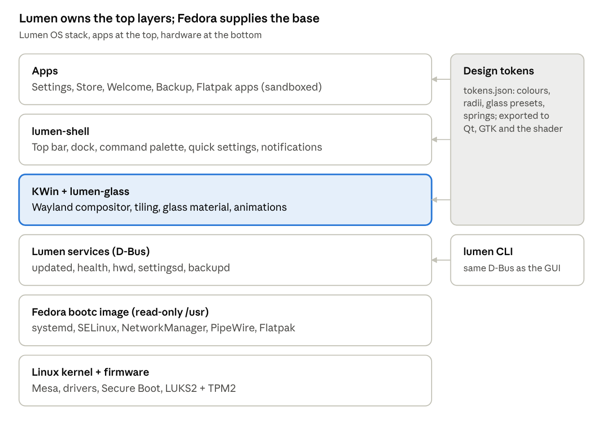

# Perfect Linux Distro — Spec & Build Prompt

Oct 26, 2026 · @Edmund

## Strategy: build on proven parts, own the experience

Build the distro as an image-based layer on Fedora (bootc / atomic), with KDE's KWin compositor as the engine and a custom shell, theme and apps on top. Writing a kernel, init system or compositor from scratch would take years and still lose to existing work; every great modern OS (macOS on Darwin, ChromeOS on Gentoo, SteamOS on Arch) wins on integration, not on reinventing the base.

What we own is everything the user touches: the shell, the glass design system, the settings app, the update and app story, the installer and the defaults. Working name below: **Lumen OS** (placeholder).

Lumen is built to be a real alternative to Windows. Someone switching keeps their files, apps, games and devices, and where something won't come with them, Lumen says so honestly *before* they install and offers the best way around it. The full list of what stops Linux competing with Windows today, and what Lumen does about each item, is `docs/competing-with-windows.md`; the decision is ADR 0001.

Why this base:

- **Fedora bootc**: atomic, image-based updates with rollback; new kernels and Mesa quickly; strong upstream security (SELinux, signed images).
- **KWin (Wayland)**: the most mature Wayland compositor, with HDR, VRR, fractional scaling and an effects API that can render real backdrop glass, which only the compositor can do.
- **Qt 6 / QML**: GPU-rendered UI with shader effects, so the shell and apps can share one glass material.

Scope honestly: Claude Code can build a working, bootable v0.1 image with the shell, theme, glass effect and core tools over many sessions. A polished consumer OS is a multi-year, multi-person effort; the prompt is staged so each phase ships something usable.

## Problems to solve

Most desktop Linux pain is not missing features but inconsistency, breakage and the terminal being the fallback for everything. Each row below maps a real pain to the fix this distro commits to.

| Problem today | Lumen OS fix |
| --- | --- |
| Updates can break the system mid-install or after reboot | Atomic image updates, staged in the background, one-click rollback from the boot menu and Settings |
| Too many ways to install apps (apt, rpm, Flatpak, Snap, AppImage, tarballs) | One App Store over Flatpak; system layer stays immutable; dev tools live in containers |
| Fixing anything means the terminal | Every common task has a GUI; errors show a plain-English cause and a Fix button |
| Inconsistent look between GTK, Qt, Electron and Flatpak apps | One design token set exported to Qt, GTK 4/libadwaita, GTK 3, and icon/cursor themes; portals for file pickers |
| Hardware hit-and-miss: NVIDIA, Wi-Fi, fingerprint, printers, sleep | Hardware check on the live USB before install; NVIDIA drivers signed into the image; driver status page in Settings |
| Fractional scaling and multi-monitor quirks | Wayland-only, per-monitor scale, HDR and VRR on by default where supported |
| Battery life worse than Windows/macOS | power profiles (tuned-ppd) tuned per device class, reliable suspend with a safe shutdown at critical battery, per-app energy view. No hibernation while Secure Boot lockdown blocks it (ADR 0001) |
| Gaming setup is fiddly | Steam, Proton, Gamescope and MangoHud preinstalled; a Game Mode toggle; Heroic and Lutris for other launchers; anti-cheat status shown before install |
| Windows apps don't run, and nobody tells you which will | A plain-English compatibility rating before every install; double-click an `.exe` to install it with a tested recipe into its own sandboxed bottle (Wine via Bottles); web apps and named alternatives when an app won't run |
| No honest answer about what will come with you | Hardware check and "Your Windows apps" report before and during setup: what works, what needs an alternative, what won't |
| Installing alongside or replacing Windows is risky | Lumen Setup for Windows checks BitLocker, Fast Startup and Secure Boot certificates and makes room safely; Health catches clock and boot-menu problems after Windows updates |
| Vendor apps for mice, keyboards and RGB are Windows-only | Device rules in the image; OpenRGB, Piper and Solaar in the Store |
| Video plays badly or drains the battery | Codecs and hardware video decoding chosen and shipped deliberately (ADR, owner's decision) |
| File sharing and cloud | Built-in SMB, phone link (KDE Connect), cloud accounts and a OneDrive client |
| Fragmented settings spread across tools | One searchable Settings app covering everything, including firewall, backups and drivers |
| No real backup story for normal users | Btrfs snapshots of /home hourly, plus a Time Machine-style external backup wizard |
| Security left to the user | Secure Boot, full-disk encryption with TPM unlock, sandboxed apps, firewall on, automatic security updates |

## Requirements

These are the must-haves for v1, grouped by area. Each is testable, so Claude Code can check them off.

### Base system

- Fedora bootc base image, built reproducibly in CI (GitHub Actions) and signed with cosign.
- Btrfs root with compression (zstd), automatic snapshots, and a read-only system image.
- Latest stable kernel and Mesa; Wayland-only session; PipeWire audio; NetworkManager; systemd-boot or GRUB with Secure Boot.
- x86_64 first; ARM64 (incl. Snapdragon X laptops) as a later target once upstream support matures.

### Updates

- Updates download and stage silently; apply on next reboot; never interrupt work.
- Previous image always kept as a rollback deployment; any earlier signed release can be restored from Settings; rollback from Settings or the boot menu in one step.
- Clear update notes in plain English; firmware updates via fwupd in the same flow.

### Apps

- App Store (Flathub + curated picks) with ratings, permissions shown before install, and automatic updates.
- Distrobox/Toolbx for developers who need apt/dnf/pacman inside containers.
- Preinstalled: browser, files, text editor, terminal, media player, office suite, screenshot/recording, calculator, backup.

### Hardware

- Live USB runs a hardware compatibility report before install.
- NVIDIA proprietary driver variant image; Intel/AMD out of the box.
- Fingerprint, touchpad gestures (3- and 4-finger), pen input, printers (driverless IPP), Bluetooth audio codecs.

### Security and privacy

- Full-disk encryption by default, TPM2 auto-unlock with PIN option.
- Firewall on; apps sandboxed through Flatpak portals; camera/mic/location indicators in the top bar.
- No telemetry by default; opt-in crash reports only.

### Performance

- Boot to desktop under 10 seconds on NVMe; idle RAM under 1.5 GB.
- Shell animations at a locked 60 fps on integrated graphics; 120 Hz where the display supports it.

### Gaming and creative

- Steam, Proton, Gamescope, MangoHud, GameMode; controller support out of the box.
- Colour-managed display pipeline, HDR, and low-latency PipeWire for audio work.

### Switching from Windows

- Double-clicking an `.exe` or `.msi` always opens the "Open Windows app" dialog, never "no app can open this file".
- Every Windows app gets a compatibility rating before install, with the reason and alternatives. Ratings are looked up offline and send no network requests.
- Every app on the top-100 list (`docs/windows-apps.md`) has a rating and at least one path: runs, installable web app, or a named alternative. At least 80% are covered.
- Windows apps can't read the home folder unless the user allows it; removing a Windows app removes its bottle completely.
- Anti-cheat status is shown before installing a game.
- Wine's `ntsync` kernel module is loaded on every image.
- The Windows drive can be imported and scanned even when BitLocker is on (with the recovery key).
- "Install alongside Windows" never resizes a BitLocker volume from Linux.
- The hardware check warns, before Windows is erased, when the firmware lacks the Microsoft UEFI CA 2023.

### Accessibility and internationalisation

- Screen reader (Orca), full keyboard navigation, large text, high contrast, reduced motion and reduced transparency.
- All UI strings translatable; right-to-left layouts; input methods (IBus/Fcitx5) set up automatically.

## Liquid glass: how to do it right

Glass must be rendered in the compositor, used only on navigation chrome, and must adapt its tint so text always stays readable. Those three rules are what separate a beautiful glass UI from a slow, illegible one.

### Where it lives

- A KWin effect plugin (C++ and GLSL) renders the glass material. Only the compositor can see what sits behind a window, so app-side fakes look flat.
- Surfaces opt in through a Wayland protocol (KDE's blur protocol now; ext-background-effect when stable). The shell, dock, menus, notifications, sidebars and title bars use it.
- Content stays solid: documents, web pages, code and media never sit on glass.

### The material, layer by layer

1. Backdrop sample: what is behind the surface.
1. Blur: dual-Kawase at quarter resolution, computed once per frame for the whole screen and shared by every glass surface.
1. Refraction: near the rounded edges, UVs bend using the shape's signed distance field, giving the liquid lens look.
1. Vibrancy: a mild saturation and brightness lift.
1. Adaptive tint: measure the luminance under the surface and adjust tint opacity to keep text contrast at 4.5:1 or better (WCAG AA).
1. Rim light: a thin specular edge, plus fine grain to stop colour banding.

### Motion

- Spring physics (not fixed curves) for open, close and morph; menus grow out of the button that opened them.
- Glass shapes merge and split as they move (metaball-style), e.g. dock icons lifting off on hover.

### Performance tiers

| Tier | What renders | When |
| --- | --- | --- |
| Full | Blur, refraction, rim light, morphing | Discrete or strong integrated GPU on mains power |
| Lite | Cached blur and tint only | Weak GPU, battery saver |
| Solid | Opaque frosted colour | Reduce Transparency setting, remote sessions, software rendering |

The tier is picked automatically by a short GPU benchmark at first boot and can be overridden in Settings. Blur is only recomputed for screen regions that changed, which keeps idle GPU use near zero.

### Design tokens

One token file (JSON) defines colours, radii, blur strength, tint ranges, spacing and motion springs. A build step exports it to QML, GTK 4 CSS, GTK 3 CSS, Kvantum and an icon set, so every app family matches.

## Easy by default, powerful underneath

A new user should never need the terminal, and a power user should never be blocked by the GUI. The shell is designed in layers: simple surface, deeper panels, full control.

### The shell

- Top bar: clock, status, quick settings, notifications. Floating glass dock at the bottom with running apps and pins.
- Command palette (Super + Space): launch apps, search files, run settings, do maths, convert units, run commands. One search box for everything.
- Window tiling built in: drag to edges or use Super + arrows; optional auto-tiling mode per workspace.
- Workspaces overview with a three-finger swipe; per-monitor workspaces.

### Easy

- First-run setup in under 2 minutes: language, Wi-Fi, account, privacy choices, theme (light, dark, auto), import from Windows/macOS folders.
- Plain-English errors with a Fix button; a System Health page that runs checks and repairs common faults.
- Sensible defaults everywhere so most people never open advanced settings.

### Powerful

- Every setting is also a config file and a CLI command (`lumen settings set ...`), so it can be scripted and synced.
- Advanced toggle in each Settings page reveals expert options instead of hiding them in another tool.
- Per-app rules (which monitor, which workspace, which GPU, power profile).
- Developer mode: one switch installs toolbox containers, git, editors, Docker/Podman and language runtimes.

### Consistency rules

- One keyboard shortcut scheme, shown in a searchable overlay (Super + /).
- One file picker (portals) everywhere; one notification style; one settings app.
- Every animation can be reduced; every glass surface can turn solid.

## Architecture



Lumen OS stack · 6 layers

Everything below the services layer comes from Fedora and KDE upstream; the compositor effect, shell, services and apps are what Lumen builds, all styled from one token file.

Licence: Lumen's code is GPL-3.0-or-later; the compatibility database is ODbL 1.0 (ADR 0003).

## Spec: image build and layout

The OS is a single OCI container image built from a Containerfile, so the whole system is versioned, reproducible and rolled back as one unit.

### Base and build chain

1. `FROM quay.io/fedora-ostree-desktops/kinoite:<current Fedora release>`: Fedora's KDE atomic image, which already carries KWin, Qt 6 and the Plasma libraries we reuse.
1. Layer Lumen packages (RPMs built in our COPR repo) and remove unwanted defaults.
1. Copy config overlays from `image/overlay` into the image. Vendor defaults go in `/usr/lib` and `/usr/share` wherever the software reads them there (systemd, polkit, sysctl, udev, XDG data directories). Config that only exists in `/etc` goes in the image's `/etc`, which bootc treats as the default and 3-way merges with local changes on every update. Never create `/usr/etc`: it is a bootc implementation detail and `bootc container lint` rejects it (ADR 0002).
1. Run `bootc container lint` to catch image mistakes.
1. Push to `ghcr.io/<org>/lumen:<channel>` signed with cosign; build the qcow2 with `bootc-image-builder` and the live install ISO from the image (see "Installer", ADR 0002).

### Image variants

| Image tag | Who it is for | Difference |
| --- | --- | --- |
| lumen:stable | Everyone | Default image, updated every 2 weeks |
| lumen-nvidia:stable | NVIDIA GPU owners | Proprietary driver as signed kmod, built with akmods in CI |
| lumen-gaming:stable | Gamers | Adds Steam, Gamescope session, MangoHud, controller udev rules |
| lumen:beta | Testers | Next Fedora release, weekly builds |

### Package manifest (system layer)

| Area | Included | Removed from Kinoite |
| --- | --- | --- |
| Desktop | KWin, Plasma libraries, LayerShellQt, KRunner, xdg-desktop-portal-kde, lumen-shell, lumen-glass | Stock Plasma panels and default plasmoids |
| System | bootc, flatpak, distrobox, podman, snapper, btrfs-progs, fwupd, tuned-ppd (power profiles; it conflicts with power-profiles-daemon, so only one can ship), ntsync autoload (Wine) | discover (replaced by Lumen Store) |
| Hardware | Mesa, Intel/AMD firmware, sof-firmware, fprintd, iio-sensor-proxy, cups + ipp-usb, sane-airscan, bluez, device rules for OpenRGB and libratbag (ratbagd) | none |
| Media | PipeWire, WirePlumber, ffmpeg-free plus codecs via Flatpak runtime; system codecs and hardware video decoding per the codecs ADR (step 1.14) | none |
| Network | NetworkManager-openconnect (Cisco, GlobalProtect, Fortinet VPNs) | none |
| Input | IBus and Fcitx5, Inter and JetBrains Mono fonts, Noto CJK and emoji, metric-compatible fonts for Office documents (Liberation, Carlito, Caladea) | Unused font packs |

User apps (browser, office, media, editor, Bottles) ship as Flatpaks preinstalled on first boot, not baked into the image, so they update independently.

### Filesystem layout

| Path | Writable | Purpose |
| --- | --- | --- |
| /usr | No | The OS image |
| /etc | Yes (3-way merged on update) | Machine config |
| /var | Yes | State, Flatpaks, containers |
| /home (Btrfs subvolume) | Yes | User data, snapshotted hourly |
| /var/lib/lumen | Yes | Lumen service state, benchmark results, health logs |

## Spec: updates, rollback and backup

One daemon, `lumen-updated`, owns every kind of update so the user sees one queue, one notification and one restart prompt.

### Update flow

1. A systemd timer wakes the daemon every 6 hours (and on network connect if the last check is over 24 hours old).
1. It checks, in order: OS image (`bootc upgrade --check`), Flatpaks (`flatpak update --no-deploy`), firmware (`fwupdmgr get-updates`).
1. Downloads run at low I/O and CPU priority, pause on metered networks and below 20% battery unless plugged in.
1. The OS image is staged with `bootc upgrade`; Flatpaks apply immediately when the app is not running; firmware waits for user consent.
1. One notification: "Update ready: restart when convenient" with Restart Now, Tonight, or Later.
1. After reboot, a boot health check runs within 2 minutes without waiting for anyone to log in: the login screen is up, NetworkManager is running (not necessarily connected, since a laptop may be offline), and no critical units failed. If it fails on two boots in a row, the boot loader automatically falls back to the previous deployment and Settings shows what happened.
1. At the first login after an update, a session check confirms the shell started. If it didn't, the user is offered "Go back to the previous version"; this is not automatic, because one user's broken session shouldn't roll back the whole machine (ADR 0002).

### Rollback

- Settings > Updates > History lists every installed image with its date and release notes.
- "Go back to this version" runs `bootc rollback` (previous) or `bootc switch` to an older signed tag.
- The boot menu (shown by holding Shift) lists the current and previous deployment.

### Snapshots and backup

- snapper snapshots `/home` hourly; keeps 24 hourly, 7 daily, 4 weekly. Files app shows "Previous versions" on any file or folder.
- Backup app (built on restic) backs up to an external drive, SMB/NFS share or S3-compatible cloud, encrypted, on a schedule; restore is browse-and-click.
- First-run setup offers backup when a second drive is detected.

## Spec: lumen-glass effect

lumen-glass is a KWin 6 effect plugin, started as a fork of KWin's built-in blur effect (which already does dual-Kawase blur and honours the blur protocol), extended with refraction, adaptive tint, rim light, rounded corners and tiers.

### How surfaces ask for glass

- Wayland clients: `org_kde_kwin_blur` region (Qt apps via `KWindowEffects::enableBlurBehind`). Add `ext-background-effect-v1` support when it lands in KWin.
- GTK apps: GTK 4 has no loadable modules and Flatpak apps can't load modules from the host, so GTK apps get glass from the compositor instead (ADR 0002). The GTK 4 and GTK 3 themes make header bars and sidebars translucent, and lumen-glass draws glass behind the whole window for GTK apps on an opt-in list of app IDs kept with the tokens. Glass shows only where the theme left the window translucent; content stays opaque.
- Glass style per surface is set by a window property or shell role: `bar`, `dock`, `menu`, `popover`, `notification`, `sidebar`, `titlebar`. Each role maps to a preset in tokens.json.
- Windows that request nothing get rounded corners and a soft shadow only.

### Render pipeline per frame

1. Collect damaged regions that lie under any glass surface. If none, reuse last frame's blur textures (idle cost near zero).
1. Downsample the backdrop 4 times (dual-Kawase down passes), then upsample twice to get a 1/4-resolution blur texture shared by every glass surface.
1. For each glass surface, run the material shader (below) clipped to its rounded rectangle.
1. Draw the surface's own content (text, icons) on top.

### Material shader (GLSL, one fragment pass)

- Signed distance field of the rounded rect gives distance `d` from the edge.
- Refraction: within `refractWidth` of the edge, offset the blur-texture UV along the edge normal by `refractStrength * (1 - d / refractWidth)^2`. Sample R, G and B with slightly different offsets for faint dispersion.
- Vibrancy: convert to HSL, multiply saturation by `vibrancy`, clamp.
- Adaptive tint: read the average luminance `L` of the backdrop from the smallest mip. Choose tint opacity so the theme's text colour has at least 4.5:1 contrast against the result. Light theme pushes the tint towards white as `L` drops; dark theme towards black as `L` rises.
- Rim light: add a 1 px highlight on the top-left edge and a fainter one on the bottom-right, brightness `rimStrength`.
- Grain: add blue-noise dither (texture, not random) at 1/255 amplitude to stop banding.

### Parameters (tokens.json defaults)

| Parameter | Default | Range |
| --- | --- | --- |
| blurRadius (px at full res) | 24 | 8 to 48 |
| refractWidth (px) | 14 | 0 to 32 |
| refractStrength (px) | 6 | 0 to 16 |
| vibrancy | 1.35 | 1.0 to 1.8 |
| tintMin / tintMax (opacity) | 0.18 / 0.72 | 0 to 1 |
| rimStrength | 0.35 | 0 to 1 |
| cornerRadius (px) | window 14, menu 12, dock 22 | 0 to 32 |

### Tiers and fallbacks

- Full: everything above. Lite: blur at 1/8 resolution, no refraction or dispersion, cached across frames. Solid: no backdrop sampling; flat tint at `tintMax`.
- First-boot benchmark renders 8 glass surfaces over a moving test scene for 5 seconds. Above 58 fps average at native resolution = Full; above 45 = Lite; else Solid.
- On battery saver, drop one tier. Respect `Reduce Transparency` (Solid) and `Reduce Motion` (no morphing).

### Morphing and motion

- Menus and popovers animate from the rect of the control that opened them using a spring (stiffness 380, damping 30).
- Dock: adjacent glass shapes within 12 px blend with a smooth-minimum of their distance fields, so icons appear to flow together.

## Spec: lumen-shell

lumen-shell is a Plasma shell package (`org.lumen.desktop`) with our own containments and widgets written in QML, so it inherits KDE's tested backends (system tray, notifications server, media controls, KRunner) while the whole surface is ours.

| Component | What it does | Built on |
| --- | --- | --- |
| Top bar | Left: Activities button and focused app's name with its menu. Centre: clock and date (click = calendar + notifications). Right: tray, network, sound, battery, user | Plasma containment, glass role `bar`, 32 px tall |
| Dock | Bottom-centre floating glass dock; pinned + running apps, running dot, progress bars, badge counts, recent files on right-click; auto-hides when a window touches it | Plasma task manager backend (TaskManager library), glass role `dock` |
| Command palette | Super+Space; one field for apps, files (Baloo), settings pages, calculator, unit and currency conversion, shell commands (prefix `>`), web search (prefix `?`), open windows | KRunner backends with a new QML front end |
| Quick settings | Click right of the top bar: Wi-Fi, Bluetooth, Do Not Disturb, Night Light, power profile, dark mode, screen recording, volume and brightness sliders; tiles can be rearranged | Plasma applets' backends, glass role `popover` |
| Notification centre | Grouped by app, inline reply, actions, history 7 days, focus modes (Work, Gaming, Sleep) that mute chosen apps | Plasma notifications server |
| Overview | 3-finger swipe up or Super: all windows + workspaces strip + search field | KWin Overview effect, restyled |
| Tiling | Edge and corner snap, Super+arrows, saved layouts per monitor, optional auto-tile per workspace | KWin custom tiles + a KWin script for auto-tiling |
| Lock screen | Glass card over blurred wallpaper, fingerprint or password, media controls, notifications count only | KScreenLocker theme |
| Login screen | Matching glass theme, user avatars, accessibility menu | SDDM theme (Wayland greeter) |
| OSDs | Volume, brightness, keyboard layout, caps lock pills at top centre | Plasma OSD service, restyled |

The shell must start in under 1.5 seconds, use under 250 MB RAM, and redraw only when something changes.

## Spec: Lumen Settings and System Health

Lumen Settings is a new QML app with a glass sidebar and search; it reuses KDE's KCM backends (the settings modules behind System Settings) wherever they are solid, and adds custom pages where Linux has no good GUI today.

| Page | Basic options | Advanced toggle reveals | Backend |
| --- | --- | --- | --- |
| Wi-Fi & Network | Networks, hotspot, VPN import (WireGuard, OpenVPN file, OpenConnect: Cisco, GlobalProtect, Fortinet) | Static IP, DNS over TLS, proxy, MAC randomisation | NetworkManager |
| Bluetooth | Pair, battery levels | Codec choice (LDAC, aptX, AAC), LE Audio | BlueZ |
| Displays | Arrange, scale, refresh, HDR, Night Light | Colour profile (ICC), VRR policy, per-app GPU | KScreen |
| Sound | Output/input, per-app volume | Sample rate, latency, EQ | PipeWire / WirePlumber |
| Appearance | Light/dark/auto, accent, wallpaper, glass on/off | Glass tier, corner radius, fonts, icon theme | tokens + lumen-glass |
| Desktop & Dock | Dock size, auto-hide, hot corners | Tiling layouts, per-workspace rules | lumen-shell config |
| Notifications | Per-app on/off, focus modes | Sound, priority, lock-screen content | Plasma notifications |
| Power & Battery | Profile, battery health, usage per app | Charge limit (80%), suspend timing, critical-battery action (hibernate offered only where Secure Boot lockdown allows it) | tuned-ppd (power profiles), UPower |
| Privacy & Security | Camera/mic/location per app, screen lock, firewall on/off | Firewall rules, Secure Boot and TPM status, Flatpak permissions | firewalld, Flatpak portals |
| Users | Accounts, avatar, password, fingerprint | Groups, autologin | AccountsService |
| Apps | Default apps, startup apps, uninstall, Windows apps (rating, remove, reset) | Flatpak permission overrides (like Flatseal) | Flatpak |
| Updates | Status, restart, auto-update toggle | History, rollback, channel (stable/beta), firmware | lumen-updated |
| Backup | Destinations, schedule, restore | Retention, exclusions | restic |
| Drivers & Hardware | Device list with status icons | Switch to NVIDIA image, kernel arguments | lumen-hwd |
| Keyboard & Input | Layouts, shortcuts, touchpad, mouse | Remapping, compose key, input method | KWin input |
| Accessibility | Screen reader, zoom, large text, contrast, reduce motion/transparency | Sticky/slow keys, colour filters | KWin + Orca |
| Developer | Developer mode switch | Containers list, SSH server, kernel logs | distrobox, podman |
| About & Health | Device name, specs, System Health, Get help from a friend: on the same network, remote desktop with a one-time code and a visible indicator; over the internet, RustDesk from the Store, with a plain note that its servers carry the connection (ADR 0002) | Logs export, Reset Lumen (keep files or erase everything) | lumen-health, Plasma remote desktop (KRdp) |

### System Health checks (each with a plain-English result and a Fix button)

| Check | Fix offered |
| --- | --- |
| Disk below 10% free | Open storage cleaner (Flatpak unused runtimes, old containers, caches) |
| Failed systemd units | Restart the unit; show log excerpt |
| Update pending more than 14 days | Restart to update |
| Firewall off | Turn on |
| Battery health below 80% | Suggest charge limit |
| Missing driver or firmware | Install firmware or switch to NVIDIA image |
| SMART or NVMe disk errors | Back up now, show details |
| Broken Flatpak or permissions | Repair (`flatpak repair`) |
| Backup not run in 7 days | Run backup now |
| Time not synced | Enable NTP |
| Windows Fast Startup left the Windows drive locked | Explain it; show the one Windows setting to turn off |
| Clock differs from Windows (local time vs UTC) | Explain it; Lumen Setup for Windows sets Windows to UTC |
| Lumen boot entry missing (often after a Windows update) | Restore the boot entry and boot order |
| Firmware lacks the Microsoft UEFI CA 2023 | Explain it; suggest Windows Update or a firmware update |

## Spec: Store, first run, installer, hardware report

These four are the user's first impression, so each must work without reading anything.

### Lumen Store

- Front end over Flathub using libflatpak and AppStream metadata; home page with curated collections (Essentials, Creative, Gaming, Developer, Windows alternatives).
- Each app page: screenshots, verified-publisher badge, permissions in plain English ("Can read your whole home folder") with a risk colour, size, last update.
- Install, update, remove and "Open" in one button; updates applied automatically by lumen-updated.
- Search understands Windows/macOS names ("Photoshop" suggests GIMP, Krita, Photopea; "Word" suggests LibreOffice, OnlyOffice) and shows the Windows app's compatibility rating next to the alternatives.
- The "Windows alternatives" collection is driven by the compatibility database.
- Web apps: install a website as an app with its own icon and window (Office on the web, Teams, Photopea, Xbox Cloud Gaming).
- Gaming collection includes Heroic (Epic, GOG) and Lutris; game pages show anti-cheat status.
- Windows apps: see "Spec: Windows apps and switching".

### Welcome (first run)

1. Language and keyboard (auto-detected from location if allowed).
1. Wi-Fi.
1. Create account: name, password or PIN, fingerprint enrolment if a reader exists.
1. Encryption: enrol TPM2 unlock with `systemd-cryptenroll --tpm2-device=auto --tpm2-with-pin` (PIN optional); show and offer to save the recovery key.
1. Privacy: location, crash reports (off by default).
1. Look: light, dark or auto; accent colour; dock position.
1. Import: copy Documents, Pictures, Music, browser bookmarks from a Windows or macOS drive. A BitLocker drive is unlocked with its recovery key, with a hint on where to find it.
1. Apps: tick-box picks (Chrome/Firefox, Spotify, Steam, Discord, VS Code, etc.), plus "Your Windows apps": the programs installed on the Windows drive, each shown as Lumen version available / runs as a Windows app / use this alternative / won't work.
1. Done: a 30-second gesture tour that can be skipped.

### Installer

- Install media: a live ISO built from the Lumen image itself (try Universal Blue's Titanoboa first). It boots into a Lumen live session that runs the hardware report, then starts the installer (ADR 0002). bootc-image-builder's `anaconda-iso` can't do this: it boots straight into Anaconda with no live desktop, and by default installs unattended to the first disk.
- Fallback, only if no live ISO works by Phase 6: `anaconda-iso` with a partial kickstart, so the user picks the disk and install mode. The hardware report then runs only in Lumen Setup for Windows and after install, which needs the owner's approval because it drops the live-USB report.
- Anaconda WebUI, running in the live session, themed with Lumen tokens.
- Three choices only: Erase disk (default, encrypted), Install alongside Windows, Custom (expert partitioning).
- Install alongside Windows uses free space the user (or Lumen Setup for Windows) made by shrinking Windows from inside Windows. If the Windows partition is plain NTFS and there is no free space, it can resize NTFS, with a warning and a backup reminder. It never resizes a BitLocker volume from Linux, and it stops with a plain-English explanation if Windows Fast Startup or hibernation has left the drive locked.
- Under 10 minutes on a typical SSD.

### Hardware report (live USB)

- `lumen-hwd report` gathers PCI/USB IDs (lspci, lsusb), firmware status (fwupd), Secure Boot state and whether the firmware trusts the Microsoft UEFI CA 2023, GPU, Wi-Fi, fingerprint, webcam, audio, sleep support.
- Compares against `hardware.json` (known good, known issues with workarounds, known broken), maintained in the repo and updated with the image.
- Shows green / amber / red per device before the user commits to install.

## Spec: Windows apps and switching

Windows apps run on Wine: desktop apps through Bottles (Flatpak), games through Proton (Steam). Lumen adds what Linux is missing: an honest answer before install, tested settings applied automatically, and a safe way to move over from Windows.

### Compatibility ratings

| Rating | Meaning | Colour |
| --- | --- | --- |
| Works great | Installs and runs with no known problems | Green |
| Works with issues | Runs; known issues listed in plain English | Amber |
| Won't work | Doesn't run, with the reason ("uses anti-cheat that blocks Linux", "the publisher doesn't support it") and alternatives | Red |
| Not tested yet | No data. The user can try; the app runs in its own bottle | Grey |

Every rating shows when and how it was last tested. Entries not tested in the last 6 months show as "Not tested yet".

### Compatibility database

- `compat/windows-apps.json`, validated against a JSON schema in CI and published under ODbL 1.0 (required because it includes ProtonDB data).
- Each entry: name, publisher, how to recognise it (PE version info such as ProductName and CompanyName, installer type, SHA-256 of known installers, Steam App ID), rating, reason, known issues, recipe, alternatives (Flatpak IDs, web app URLs), anti-cheat status, last tested (Wine or Proton version, date, by CI or a maintainer), sources.
- Recipe: Bottles environment (application or gaming), dependencies (for example Visual C++ runtimes, .NET, core fonts), DLL overrides and environment variables.
- Sources: Lumen's nightly CI tests and maintainers first; ProtonDB report exports (ODbL 1.0 + DbCL, with attribution) for games; AreWeAntiCheatYet for anti-cheat status (licence confirmed in step 7.1). Never scrape.
- Delivery: shipped in the image and refreshed as a signed file by lumen-updated. Lookups happen offline; Lumen never sends "this user is installing X" anywhere.
- The `lumen-compat` Rust crate identifies a file and looks it up. The Store, the dialog, Welcome and the CLI all use it, so they can't disagree.

### "Open Windows app" dialog

1. The user double-clicks an `.exe` or `.msi`.
1. The dialog shows the app's name and publisher (read from the file), its rating and reason, alternatives ("LibreOffice is a Lumen app that opens Word files"), and anti-cheat status for games.
1. Install creates a bottle for that app with its recipe, runs the installer, and adds the app to the app menu with its icon.
1. For "Not tested yet", the dialog says so, explains that the app runs in its own space, and offers Try it.
1. Nothing installs until the user presses a button.

### Sandbox

- Bottles runs as a Flatpak; each Windows app gets its own bottle.
- Lumen keeps Bottles' default Flatpak permissions (no home-folder access beyond Downloads) and never widens them silently. The user can grant more from Settings → Apps → Windows apps.
- Removing a Windows app deletes its bottle.

### Games

- Steam with Proton (gaming image, or ticked in Welcome); Heroic for Epic and GOG; Lutris for other launchers.
- Anti-cheat status comes from the compatibility database and shows before install.

### Lumen Setup for Windows

- A Windows program in `windows-setup/`, forked from Fedora Media Writer (Qt, which already downloads, verifies and writes USB drives on Windows). Built on a GitHub Actions Windows runner and code-signed, so Windows doesn't warn users.
- Steps: hardware check against `hardware.json` with green / amber / red; checks for BitLocker, Fast Startup, Secure Boot and the Microsoft UEFI CA 2023; shows where the BitLocker recovery key is and asks the user to save it; for "alongside Windows", shrinks the Windows partition with Windows' own tools, turns off Fast Startup and sets the Windows clock to UTC; downloads, verifies and writes the USB; explains how to boot from it.
- Every change to Windows needs its own confirm button.

### Honest limits

Lumen says these plainly in ratings, the Store and the FAQ, and offers the best alternative:

- Microsoft 365 desktop apps (use Office on the web, LibreOffice or OnlyOffice).
- Adobe Creative Cloud and some large CAD suites.
- Games whose kernel anti-cheat the publisher hasn't enabled for Linux.
- 4K video in streaming services' browser players (DRM limits).
- Windows Hello face unlock, iCloud desktop sync, and Windows-only drivers and vendor tools.

After v0.1: Windows apps in a window through a Windows virtual machine with the user's own licence; an opt-in "Report how it went" button; parental controls; local-only dictation; help from a friend over the internet without a third-party app (a Lumen relay; needs the owner's approval for its running costs and privacy).

## Spec: lumen CLI and services

Every GUI action goes through a D-Bus service, and the `lumen` CLI calls the same services, so the GUI and terminal can never disagree.

### Services

| Service (D-Bus name) | Runs as | Responsibility |
| --- | --- | --- |
| lumen-updated (`org.lumen.Updates1`) | system, root, polkit-guarded | OS, Flatpak, firmware and compatibility-database updates; rollback; post-boot health check |
| lumen-health (`org.lumen.Health1`) | system | System Health checks and fixes |
| lumen-hwd (`org.lumen.Hardware1`) | system | Hardware report, driver status, NVIDIA image switch |
| lumen-settingsd (`org.lumen.Settings1`) | user session | Reads and writes Lumen settings (stored in `~/.config/lumen/*.toml`), emits change signals |
| lumen-backupd (`org.lumen.Backup1`) | user session | restic schedules and restores |

Privileged actions use polkit with admin auth, cached 5 minutes. Services are written in Rust (zbus) for memory safety; UI apps in C++/QML.

### CLI reference

| Command | Does |
| --- | --- |
| `lumen update [--check / --now]` | Check or apply all updates |
| `lumen rollback [--list / <version>]` | List images or go back |
| `lumen settings get / set / list / export / import` | Any setting by key, e.g. `lumen settings set appearance.theme dark` |
| `lumen health [--fix]` | Run checks; optionally apply safe fixes |
| `lumen hw report [--json]` | Hardware report |
| `lumen app install / remove / list / search` | Flatpak wrapper with friendly names; `list --windows` shows Windows apps |
| `lumen app check <file>` | Compatibility rating for an `.exe` or `.msi` |
| `lumen dev enable` | Developer mode: creates a Fedora toolbox and an Ubuntu distrobox, installs git and an editor |
| `lumen backup now / list / restore` | Backups |
| `lumen glass tier <full / lite / solid / auto>` | Override the glass tier |

All commands support `--json` output and shell completion for bash, zsh and fish.

## Spec: security model

The system is secure by default with no settings changed: a stolen laptop reveals nothing, a malicious app is contained, and the OS itself cannot be silently modified.

| Threat | Defence |
| --- | --- |
| Stolen or lost device | LUKS2 full-disk encryption; TPM2 unlock bound to Secure Boot state (PCR 7) with optional PIN; recovery key shown once at setup |
| Tampered boot chain | Secure Boot with Fedora's signed shim, kernel and modules; NVIDIA and other out-of-tree kmods signed with our key, enrolled via MOK on first boot; kernel lockdown stays on (never traded for hibernation); the hardware check warns when firmware lacks the Microsoft UEFI CA 2023 |
| Malicious Windows program | Runs under Wine inside the Bottles Flatpak sandbox, one bottle per app, no home-folder access by default; the dialog shows the publisher and rating before anything runs |
| Tampered OS image | Read-only `/usr`; images signed with cosign; bootc verifies signatures before staging (policy in `/etc/containers/policy.json`) |
| Malicious or buggy app | Flatpak sandbox; portals for files, camera, screen capture; Store shows permissions before install; risky permissions flagged |
| Network attack | firewalld on, public zone by default; no listening services out of the box; SSH off unless Developer mode enables it |
| Privilege escalation | SELinux enforcing; polkit for every admin action; `sudo` requires admin group; services run with systemd hardening (ProtectSystem, NoNewPrivileges, sandboxing) |
| Screen and input snooping | Wayland isolates apps; screen sharing only via portal with a visible indicator; camera and mic indicators in the top bar |
| Supply chain | CI builds from pinned base image digests; SBOM published with every release; Renovate bot opens update PRs |
| Unpatched software | Automatic security updates; Health warns if the system is more than 14 days behind |

Privacy: no telemetry, no account required, crash reports opt-in, the Store fetches metadata anonymously, and compatibility ratings are looked up offline.

## Default shortcuts and gestures

Shortcuts use Super as the system key and stay close to what Windows and macOS users already know; all are remappable in Settings.

| Action | Keyboard | Touchpad |
| --- | --- | --- |
| Command palette | Super+Space | none |
| Overview | Super | 3-finger swipe up |
| Show desktop | Super+D | 3-finger swipe down |
| Switch workspace | Super+Ctrl+Left/Right | 4-finger swipe left/right |
| Snap / tile window | Super+Arrows | Drag to edge |
| Maximise / restore | Super+Up / Super+Down | Double-click title bar |
| Move window to next monitor | Super+Shift+Left/Right | none |
| Switch apps | Alt+Tab | 3-finger swipe left/right |
| Close window | Super+Q or Alt+F4 | none |
| Lock screen | Super+L | none |
| Screenshot / record | Print, Super+Shift+S (region), Super+Shift+R (record) | none |
| Files | Super+E | none |
| Terminal | Super+T | none |
| Settings | Super+I | none |
| Quick settings | Super+A | none |
| Notifications | Super+N | none |
| Emoji picker | Super+. | none |
| Clipboard history | Super+V | none |
| Shortcut cheat sheet | Super+/ | none |
| Zoom | none | 2-finger pinch (in apps), Super+scroll (screen) |

## Testing, CI and release

No image reaches users unless it boots in a VM, passes the automated checks, and has been on the beta channel for at least one week.

### Test layers

| Layer | Tool | What it proves |
| --- | --- | --- |
| Unit | Rust `cargo test`, Qt Test for C++/QML | Services and app logic |
| Image lint | `bootc container lint`, package diff vs last release | Image is valid; no surprise package changes |
| Boot test | QEMU + qcow2 from bootc-image-builder, run in CI with KVM | Boots to SDDM in under 60 s; no failed units |
| Session test | KWin virtual backend (`kwin_wayland --virtual`) + scripted D-Bus calls + screenshots | Shell starts, dock/bar/palette open, glass renders |
| Glass visual test | Render 12 reference scenes (busy photo, white page, black, video frame); compare to golden images; compute text contrast | No visual regressions; contrast at least 4.5:1 on every scene |
| Performance | Boot time (systemd-analyze), idle RAM, shell CPU, glass frame time on reference hardware | Budgets in Requirements are met |
| Update test | Install previous release, upgrade to new, reboot, roll back, reboot | Updates and rollback work every release |
| Windows compatibility | Nightly CI: install and launch freely downloadable Windows apps under the image's Wine and Bottles, screenshot the window | Ratings in the compatibility database stay true |
| Accessibility | Orca smoke test, keyboard-only navigation script, axe-style checks on QML | Usable without mouse or sight |
| Hardware lab | 6 reference laptops (Intel, AMD, NVIDIA, a cheap one, a high-DPI one, an older one) | Real-device sign-off before stable |

### Release train

- Every merge to `main` builds `lumen:dev`.
- Weekly `lumen:beta` from main after green CI.
- Every 2 weeks, the beta that has been out 7 days with no blocker becomes `lumen:stable`.
- Major Fedora version rebase: beta for 4 weeks before stable.
- Every release publishes signed images, ISO, SBOM, changelog in plain English, and checksums.

## Claude Code prompt

The prompt is a pack: one project memory file Claude Code reads every session, then one prompt per phase, each with acceptance tests it must pass before you move on.

### Before you start

1. A Linux machine (Fedora is easiest) or a VM with nested KVM, Podman, 100 GB free disk, 16 GB RAM.
1. A GitHub account and an empty repo `lumen-os`; a COPR account for building RPMs.
1. Export this doc as Markdown and save it in the repo as `docs/spec.md`. It is the source of truth Claude Code works from.
1. Save the first block below as `CLAUDE.md` in the repo root.
1. Paste Phase 0. When it finishes and its tests pass, paste Phase 1, and so on. Expect each phase to take several sessions.

### CLAUDE.md (project memory)

```text
# Lumen OS — project memory

You are the lead engineer of Lumen OS, a desktop Linux distribution. The full specification is docs/spec.md. Read it before every phase. If the spec and this file disagree, the spec wins; if the spec is technically wrong, stop and tell me.

## Product
Easy by default, powerful underneath, never breaks, liquid-glass design, and a real alternative to Windows. A new user never needs a terminal; a power user is never blocked by the GUI.

## Fixed architecture
- Image: OCI image FROM quay.io/fedora-ostree-desktops/kinoite:<current Fedora>, managed by bootc. Built with Podman; qcow2 via bootc-image-builder; the install ISO is a live ISO built from the image (ADR 0002).
- Compositor: KWin 6 (Wayland only). Glass: KWin effect plugin "lumen-glass" (fork of KWin's blur effect).
- Shell: Plasma shell package org.lumen.desktop with our own QML containments/plasmoids.
- Apps: Qt 6/QML (C++). System services: Rust with zbus. CLI: Rust (clap).
- User apps: Flatpak/Flathub only. Dev tools: distrobox/toolbx.
- Windows apps: Wine via Bottles (Flatpak) and Proton (Steam); ratings from the Lumen compatibility database, looked up offline.
- Security: Secure Boot, LUKS2 + TPM2, SELinux enforcing, firewalld, cosign-signed images, no telemetry.

## Critical build rule
KWin and Plasma plugins have no stable ABI. lumen-glass and lumen-shell must be compiled in a multi-stage Containerfile stage FROM the same base image digest they ship in, against that image's kwin-devel / plasma-workspace-devel, then installed as RPMs. Never build them against a different KWin version.

## Repo layout
image/ (Containerfile, overlay/, packages.toml), design/tokens/ (tokens.json + exporters), glass/, shell/, apps/settings, apps/store, apps/welcome, apps/backup, apps/windows-app (the "Open Windows app" dialog), services/ (updated, health, hwd, settingsd, backupd), cli/, compat/ (compatibility database, schema, lumen-compat crate), windows-setup/ (Lumen Setup for Windows), installer/, hardware/hardware.json, tests/, docs/.

## Working rules
- Work one phase at a time. At the end of each phase: run every acceptance test, show results, list known issues, wait for "continue".
- Prefer upstream components; patch only when needed and record why in docs/decisions/NNNN-title.md (ADR format).
- Every feature ships with tests. CI must stay green. Small commits, conventional commit messages.
- Never weaken a security default to make something work. Never disable SELinux, Secure Boot or signature checks.
- All user-facing strings are translatable (Qt tr / gettext) and written in plain English.
- Respect Reduce Motion and Reduce Transparency everywhere.
- When unsure, ask one specific question rather than guessing.
```

### Phase 0: plan and skeleton

```text
Read CLAUDE.md and docs/spec.md fully. Then:
1. Write docs/architecture.md: components, how they talk (D-Bus names, files, protocols), build flow, and a dependency graph.
2. Write docs/risks.md: top 15 technical risks (e.g. KWin ABI churn, NVIDIA signing, TPM enrolment UX, the Secure Boot UEFI CA 2023 transition, hibernation under kernel lockdown, codec patents, BitLocker on Windows drives, Windows code signing for Lumen Setup, licences of compatibility data) with mitigations.
3. Create the full repo skeleton from CLAUDE.md with README files, and a justfile with targets: build-image, build-iso, run-vm, test, lint.
4. Set up GitHub Actions: lint job, and a placeholder build job.
5. Check which Fedora release and KWin version are current in the Kinoite image and record them in docs/versions.md.
Acceptance: `just lint` passes; CI green; docs reviewed by me.
```

### Phase 1: bootable image

```text
Build the base image per docs/spec.md "Spec: image build and layout".
1. image/Containerfile: FROM kinoite (pinned by digest); install packages from image/packages.toml; remove the stock Plasma default layout and Discover; copy image/overlay into the image (vendor defaults in /usr/lib and /usr/share, /etc only where needed, never /usr/etc); enable services (firewalld, fwupd-refresh.timer, snapper timers, tuned-ppd); SELinux enforcing; run `bootc container lint`.
2. Btrfs defaults and snapper config for /home (24 hourly, 7 daily, 4 weekly).
3. Variants: lumen (default), lumen-nvidia (akmods-built signed kmods; MOK enrolment doc), lumen-gaming.
4. CI: build all variants, push to ghcr.io with cosign signatures, generate SBOM (syft), build the qcow2 with bootc-image-builder and the live install ISO from the image (anaconda-iso only as the fallback in "Installer").
5. tests/boot: boot the qcow2 in QEMU/KVM in CI, assert SDDM reached within 60 s and `systemctl --failed` is empty.
6. Configure /etc/containers/policy.json so the system only accepts our signed images.
7. Windows-app base: ntsync autoload, Bottles preinstalled on first boot, .exe and .msi open in Bottles until the Phase 7 dialog exists, metric-compatible fonts. Boot test checks /dev/ntsync exists and records whether kernel lockdown is on and hibernation is offered under Secure Boot.
8. Codecs and hardware video decoding: write the options and their legal trade-offs as an ADR; the owner chooses; ship the choice.
9. Compatibility database v0 in compat/: JSON schema, validation test, first 20 entries, ODbL licence file.
10. Nightly CI job: install and launch freely downloadable Windows apps under the image's Wine, screenshot the window, update each entry's "last tested".
Acceptance: ISO installs in a VM with encryption; system boots; `bootc status` shows our signed image; `bootc upgrade` to a newer CI build and `bootc rollback` both work; double-clicking an .exe opens Bottles; the compatibility job is green.
```

### Phase 2: design tokens and theme

```text
Implement design/tokens per the spec's "Liquid glass" and "Design tokens" sections.
1. tokens.json: colours (light, dark, 8 accents), type scale (Inter), radii, spacing (4 px grid), elevation/shadows, glass presets per role (bar, dock, menu, popover, notification, sidebar, titlebar) with all parameters in the spec's table, spring presets.
2. Exporters (run at image build): QML singleton module org.lumen.style; KDE colour schemes; Qt style (Kvantum); GTK 4/libadwaita CSS; GTK 3 theme; window decoration (KDecoration plugin) with rounded corners and glass titlebar role; cursor and icon theme config (an open icon set with accent recolouring).
3. Global theme (look-and-feel package) org.lumen.desktop.
4. Visual test: screenshot a Qt app, a GTK 4 app, a GTK 3 app and a Flatpak app in light and dark; store as golden images.
Acceptance: all four app types visibly match in both modes; changing the accent in one place updates all of them after re-export.
```

### Phase 3: lumen-glass

```text
Implement glass/ per the spec's "Spec: lumen-glass effect" section exactly.
1. Fork KWin's blur effect (matching the image's KWin version) into a plugin named lumen-glass; build it in a Containerfile stage against that version.
2. Shared 1/4-res dual-Kawase blur computed once per frame; damage-aware caching so idle frames do no blur work.
3. Material fragment shader: rounded-rect SDF, edge refraction with RGB dispersion, vibrancy, adaptive tint guaranteeing 4.5:1 contrast against the theme text colour using backdrop luminance from the smallest mip, rim light, blue-noise dither texture.
4. Roles: read the glass role from a window property set by the shell/apps; map to presets in tokens.json; reload on token change via D-Bus.
5. Rounded corners and soft shadows for all windows; glass titlebar role.
6. Tiers Full/Lite/Solid; first-boot benchmark service (systemd oneshot) writing /var/lib/lumen/glass-tier; battery saver drops one tier; honour Reduce Transparency and Reduce Motion.
7. Spring-based open/close/morph animations; smooth-min SDF merging for dock shapes.
8. GTK clients: no GTK module (GTK 4 has none, and Flatpak apps can't load one). Draw whole-window glass for GTK apps on the opt-in list; the GTK themes make header bars and sidebars translucent.
9. Tests: run kwin_wayland --virtual in CI, render the 12 reference scenes, compare to golden images (with tolerance), compute contrast; benchmark frame time.
Acceptance: contrast >= 4.5:1 on all scenes; Full tier holds 60 fps with 8 glass surfaces on Intel Iris Xe class graphics; idle GPU use near zero; Solid tier correct with no backdrop sampling.
```

### Phase 4: lumen-shell

```text
Implement shell/ per the spec's "Spec: lumen-shell" table: top bar, dock, command palette (KRunner backends, new QML UI), quick settings, notification centre with focus modes, overview restyle, tiling (KWin custom tiles + auto-tile KWin script), lock screen, SDDM theme, OSDs. Apply every shortcut and gesture from the spec's shortcut table.
Every surface sets its glass role. Use org.lumen.style tokens only; no hard-coded colours or sizes.
Tests: QML unit tests; session test that opens each surface via D-Bus/shortcut and screenshots it; keyboard-only navigation test.
Acceptance: shell starts < 1.5 s, < 250 MB RAM, ~0% CPU idle; every shortcut works; every surface is reachable by keyboard and announced by Orca.
```

### Phase 5: services, CLI and Settings

```text
Implement services/ and cli/ per "Spec: lumen CLI and services", then apps/settings per "Spec: Lumen Settings and System Health".
1. Rust services with zbus; systemd units with hardening (ProtectSystem=strict, NoNewPrivileges, etc.); polkit policies.
2. lumen-updated: the full update flow in "Spec: updates, rollback and backup", including metered/battery rules, a single notification, a post-boot health check that needs no login with automatic fallback (greenboot-style boot counting), the first-login shell check, history and rollback to signed tags.
3. lumen-health: every check in the System Health table with its Fix.
4. lumen CLI: every command in the CLI table, --json, shell completions.
5. Settings app: every page in the table with Basic and Advanced views; reuse KCM backends where solid; search across all pages and options; deep links (lumen-settings://page/option) used by the palette and Health fixes.
Acceptance: every setting changeable from both GUI and CLI with identical results; update + rollback cycle passes in the VM; each Health check can be triggered in a test and fixed by its button.
```

### Phase 6: Store, Welcome, Backup, installer, hardware report

```text
Implement per "Spec: Store, first run, installer, hardware report" and the backup part of the updates spec.
1. Lumen Store (libflatpak + AppStream): collections, plain-English permissions, Windows/macOS name aliases (data file); Essentials adds a OneDrive client, OpenRGB, Piper and Solaar.
2. Welcome: all 9 steps, including TPM2 enrolment with recovery key and Windows/macOS file import.
3. Backup app over restic with external drive, SMB and S3 targets; "Previous versions" in Files via snapper.
4. Installer: theme Anaconda WebUI in the live session; three install modes; "Install alongside Windows" detects BitLocker and Fast Startup and never resizes a BitLocker volume.
5. lumen-hwd report + hardware/hardware.json, including the Microsoft UEFI CA 2023 check; live-session hardware report app.
Acceptance: fresh install to first usable desktop in under 15 minutes in a VM; a non-technical tester completes setup, installs an app, restores a file and runs a backup with no help.
```

### Phase 7: switching from Windows

```text
Implement per "Spec: Windows apps and switching".
1. docs/windows-apps.md: the top 100 apps Windows users need, by category, with today's status; confirm the licences of every data source. The owner reviews the list.
2. Compatibility database v1: recipes, alternatives, anti-cheat status; import ProtonDB and AreWeAntiCheatYet data with attribution; cover the top 100. Signed updates through lumen-updated; offline lookup only.
3. lumen-compat crate: identify an .exe or .msi (version info, installer type, hash) and match it; `lumen app check`.
4. "Open Windows app" dialog: rating, reason, alternatives, Install / Try it; creates the bottle with its recipe; adds the app to the menu.
5. Sandbox defaults; Windows apps in Settings → Apps; `lumen app list --windows`; full removal.
6. Store: ratings on Windows-name searches, Windows alternatives collection, web apps, Heroic and Lutris, anti-cheat status.
7. Welcome: "Your Windows apps" scan of the Windows drive, with BitLocker unlock by recovery key.
8. Lumen Setup for Windows (fork of Fedora Media Writer): hardware check, BitLocker / Fast Startup / Secure Boot checks, partition shrink, UTC clock, USB writer; built and code-signed in CI.
9. Dual-boot Health checks: Fast Startup, clock, missing boot entry, Secure Boot certificate.
Acceptance: every top-100 app has a rating and a path, and at least 80% are covered; the dialog, Store and CLI give the same rating; a lookup makes no network request; a Windows user installs Lumen with Lumen Setup, sees their apps' status, and installs five Windows apps by double-clicking, with every rating correct.
```

### Phase 8: hardening, accessibility, performance

```text
1. Security review against the spec's threat table, including Windows-app bottles and Lumen Setup; fix gaps; document in docs/security.md.
2. Accessibility audit of every app and shell surface (Orca, keyboard, contrast, large text, reduced motion/transparency).
3. Performance pass: boot < 10 s on NVMe, idle RAM < 1.5 GB; profile and fix the top offenders.
4. Translations: extract strings, set up Weblate config, ship English plus a pseudo-locale for testing.
Acceptance: all budgets met in CI and on a real laptop; no failing accessibility checks.
```

### Phase 9: release v0.1

```text
1. Release train in CI: dev on every merge, weekly beta, stable every 2 weeks after 7 days in beta.
2. Update test job: install previous release, upgrade, reboot, rollback, reboot.
3. Docs: user guide, install guide, FAQ, hardware notes, contributing guide.
4. Publish signed images, ISO, SBOM, checksums and a plain-English changelog.
Acceptance: v0.1 ISO installs and runs on at least two real machines, one of them alongside Windows through Lumen Setup; every test layer in the spec's Testing table passes.
```
